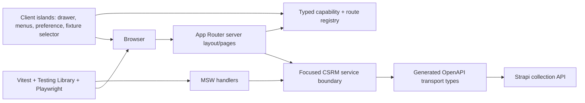

# Phase 6: CSRM Foundation - Research

**Researched:** 2026-08-09  
**Domain:** Next.js App Router application foundation, typed Strapi transport, capability-driven shell, and browser/test infrastructure  
**Confidence:** MEDIUM

<user_constraints>
## User Constraints (from CONTEXT.md)

### Locked Decisions
- Organize application source under `apps/csrm/src` using App Router plus feature-oriented `features`, `domain`, `lib`, and `config` directories.
- Use Server Components by default and isolate interactive behavior in small, explicit Client Components.
- Prefer server state, URL state, and local React state; do not add a global state library without a concrete requirement.
- Name the workspace package `@idambox/csrm`, integrate it with root Turbo scripts, and configure its development port independently from Strapi and Keycloak.
- Use a light-first enterprise visual treatment with restrained BProton styling, strong typography, generous whitespace, and blue/teal accents.
- Express branding through semantic CSS tokens with light and dark-ready values; reusable components must not scatter raw brand colours.
- Provide a collapsible, domain-grouped desktop sidebar with product identity and clear active-route treatment.
- Provide a compact mobile header and accessible navigation drawer; content and actions reflow responsively rather than shrink in place.
- Include contextual page heading or breadcrumbs and an account menu in the shell. Generate navigation visibility from centralized capabilities.
- Derive stable capability identifiers from the existing Function catalogue and expose them through one typed registry; do not invent competing frontend-only permission names or scatter role-string checks.
- Combine birthright Requestor capabilities with explicitly assigned elevated roles such as Security Analyst. Keycloak proves identity but is not the authorization source.
- Provide deterministic Requestor and Security Analyst fixtures, with an identity/role switcher available only in development and automated tests.
- Hide unavailable navigation and actions for usability, and render a proper forbidden state for direct unauthorized route access. Backend authorization remains authoritative.
- Generate TypeScript transport types from `apps/csrm/docs/references/specification.json`, then wrap them in focused domain services rather than exposing a generated SDK throughout UI code.
- Use MSW as the HTTP-level Strapi test double so fixtures exercise the same production service contract.
- Normalize transport failures into typed API errors and discriminated service results.
- Use Vitest and Testing Library for unit/component tests, MSW for integration tests, and Playwright for desktop and mobile application-shell smoke coverage.

### the agent's Discretion
- Exact compatible dependency versions, token values, typography choices, responsive breakpoints, icon set, component composition, generated-type tooling configuration, and test-file organisation may follow current ecosystem guidance and repository conventions.
- Choose the specific independent local development port while avoiding the established Strapi and Keycloak ports.

### Deferred Ideas (OUT OF SCOPE)
- Production Keycloak/OIDC session handling and real effective-capability retrieval — Phase 13.
- Requestor, questionnaire, assessment, risk-register, administration, reporting, and alert workflows — Phases 7-12.
- Provider-independent AI services and AI workflow states — later workflow phases and Phase 13 integration.
- Customer-specific branding controls beyond dark-ready semantic tokens — future product work.
</user_constraints>

## Project Constraints (from AGENTS.md)

- Read the project, requirements, roadmap, and state planning documents before phase work. [VERIFIED: AGENTS.md:7-7]
- Preserve the platform authorization path `IdamBoxUser -> Role -> Function -> Application`, with FunctionApi operation grants attached to Functions; do not add free-floating permission strings. [VERIFIED: AGENTS.md:23-24]
- Do not use Strapi admin users as IdamBox product users, recreate Entitlement/ApplicationRole, or implement Auth0 in this phase. [VERIFIED: AGENTS.md:20-25]
- Keep phase work scoped to the active phase and verify the phase success criteria. [VERIFIED: AGENTS.md:31-31]

<phase_requirements>
## Phase Requirements

| ID | Description | Research Support |
|----|-------------|------------------|
| APP-06 | IdamBox Cyber Risk Manager can be added as a Next.js application module. | Workspace strategy, strict App Router structure, typed OpenAPI boundary, capability shell, fixture/test architecture, and phase gate are specified below. [VERIFIED: .planning/REQUIREMENTS.md:73-75] |
</phase_requirements>

## Summary

Build one self-contained Yarn/Turbo workspace at `apps/csrm` and make the Phase 6 landing page (`/`) the only enabled application destination. Keep the outer layout and data-capable service modules server-first; place the drawer, desktop-collapse preference, account menu, live-region fixture switcher, and any browser storage behind narrow Client Component boundaries. This matches the locked UI contract and the current App Router model: layouts and pages are Server Components by default, while state, event handlers, and browser APIs require client code. [CITED: https://nextjs.org/docs/app/getting-started/server-and-client-components]

Generate types only from the committed Strapi OpenAPI 3.1 document and expose a hand-authored, focused service interface above those types. This is not merely stylistic: the committed transport contract lists generic Strapi collection endpoints such as `"/csrm-assessment-requests"`, while the separate Function catalogue contains proposed feature-operation grants such as `"GET:/api/v1/my_requests"`; those are not equivalent contracts. The UI must use the Function identifiers for capability visibility/route guards, not use FunctionApi URLs as a current HTTP client map. [VERIFIED: apps/csrm/docs/references/specification.json:1-13] [VERIFIED: apps/csrm/docs/references/specification.json:3165-3168] [VERIFIED: apps/csrm/docs/references/idambox-csrm-role-function-api-catalogue.json:576-590]

The phase should establish deterministic development/test identities and MSW handlers around the same request boundary, not fake domain data in visual components. Use Vitest/Testing Library for pure logic and interactive compositions, and Playwright for true shell behavior and screenshots at the required desktop/tablet/mobile widths. Async Server Component behavior belongs in Playwright coverage because the Next.js testing guide notes incomplete unit-tool support for that case. [CITED: https://nextjs.org/docs/app/guides/testing] [CITED: https://mswjs.io/docs/integrations/node/] [CITED: https://playwright.dev/docs/next/test-snapshots]

**Primary recommendation:** Create `@idambox/csrm` on port 3001, use Next 16/App Router with React 19 and Tailwind 4, generate `src/lib/api/generated/openapi.ts` from the committed contract, and divide the implementation into foundation/tooling, capability/domain boundary, and responsive-shell/test-evidence plans.

## Architectural Responsibility Map

| Capability | Primary Tier | Secondary Tier | Rationale |
|------------|-------------|----------------|-----------|
| App routes, root layout, metadata, initial capability resolution | Frontend Server (SSR) | Browser / Client | App Router pages/layouts are server-first; only fixture interaction/presentation is client state. [CITED: https://nextjs.org/docs/app/getting-started/server-and-client-components] |
| Sidebar collapse, sheet, menu, fixture switcher, focus/live announcements | Browser / Client | Frontend Server (SSR) | These need state, event handlers, focus management, or browser storage. [CITED: https://nextjs.org/docs/app/getting-started/server-and-client-components] |
| Capability registry and route eligibility | API / Backend | Frontend Server (SSR) | Backend remains authoritative; the app uses its typed Function registry only for display and pre-request guards. [VERIFIED: 06-CONTEXT.md:30-34] |
| Strapi transport and error normalization | Frontend Server (SSR) | API / Backend | Server-only service modules protect future credentials and make one contract boundary; Strapi owns the actual data/authorization. [CITED: https://nextjs.org/docs/app/getting-started/server-and-client-components] |
| Semantic tokens and shadcn compositions | Browser / Client | CDN / Static | CSS and shipped component styles own appearance; shadcn supplies local component source, not a runtime design-system service. [CITED: https://ui.shadcn.com/docs/installation/next] |
| Unit/integration mock transport | Browser / Client | Frontend Server (SSR) | MSW intercepts HTTP in Node test processes and browser test/development contexts. [CITED: https://mswjs.io/docs/integrations/node/] [CITED: https://mswjs.io/docs/integrations/browser/] |

## Standard Stack

### Core

| Library | Version | Purpose | Why Standard |
|---------|---------|---------|--------------|
| `next` [CITED: https://nextjs.org/docs/app/getting-started/installation] [WARNING: flagged as suspicious — verify before using.] | `16.3.0` [VERIFIED: npm registry] | App Router, SSR/RSC, routing, build | Current official documentation requires Node 20.9+ and documents TypeScript/Tailwind/App Router defaults. [CITED: https://nextjs.org/docs/app/getting-started/installation] |
| `react` / `react-dom` [CITED: https://nextjs.org/docs/app/getting-started/installation] [WARNING: flagged as suspicious — verify before using.] | `19.2.8` / `19.2.8` [VERIFIED: npm registry] | Next peer runtime | Current Next installation guidance declares both for ecosystem/tooling compatibility. [CITED: https://nextjs.org/docs/app/getting-started/installation] |
| `tailwindcss`, `@tailwindcss/postcss`, `postcss` [CITED: https://tailwindcss.com/docs/installation/framework-guides/nextjs] [WARNING: flagged as suspicious — verify before using.] | `4.3.3`, `4.3.3`, `8.5.26` [VERIFIED: npm registry] | Utility CSS, semantic tokens, PostCSS build integration | Tailwind’s current Next guide uses the PostCSS plugin and a global CSS import. [CITED: https://tailwindcss.com/docs/installation/framework-guides/nextjs] |
| shadcn/ui official CLI [CITED: https://ui.shadcn.com/docs/installation/next] | CLI-only, pin during plan execution [ASSUMED] | Generate the approved local Radix component sources | Its official Next/monorepo docs support `src` aliases, RSC, CSS variables, and workspace targeting. Review each official component with `shadcn view`/`--dry-run` before writing. [CITED: https://ui.shadcn.com/docs/cli] |
| `openapi-typescript` [CITED: https://openapi-ts.dev/cli] [WARNING: flagged as suspicious — verify before using.] | `7.13.0` [VERIFIED: npm registry] | Build-time OpenAPI-to-TypeScript generation | The official CLI supports local JSON/YAML input and a generated output file. [CITED: https://openapi-ts.dev/cli] |

### Supporting

| Library | Version | Purpose | When to Use |
|---------|---------|---------|-------------|
| `msw` [CITED: https://mswjs.io/docs/integrations/node/] [WARNING: flagged as suspicious — verify before using.] | `2.15.0` [VERIFIED: npm registry] | HTTP-level Strapi mocking | Node server for Vitest; browser worker only for deliberate dev/test fixture mode. |
| `vitest`, `@vitejs/plugin-react`, `jsdom` [CITED: https://vitest.dev/guide/] [WARNING: flagged as suspicious — verify before using.] | `4.1.10`, `6.0.5`, `30.0.1` [VERIFIED: npm registry] | Fast unit/component runner | Pure domain, service, and Client Component tests. Vitest requires Node 20+ and Vite 6+. [CITED: https://vitest.dev/guide/] |
| `@testing-library/react`, `@testing-library/jest-dom`, `@testing-library/user-event` [ASSUMED] [WARNING: flagged as suspicious — verify before using.] | `16.3.2`, `7.0.0`, `14.6.3` [VERIFIED: npm registry] | Accessible component interaction assertions | Use for composed primitives and fixture/capability updates, not implementation-detail snapshots. |
| `@playwright/test` [CITED: https://playwright.dev/docs/test-projects] [WARNING: flagged as suspicious — verify before using.] | `1.62.1` [VERIFIED: npm registry] | Browser smoke and visual evidence | Shell behavior, focus, responsive geometry, and deterministic screenshots. |
| `lucide-react` [ASSUMED] [WARNING: flagged as suspicious — verify before using.] | `1.30.0` [VERIFIED: npm registry] | Approved icon library | Use only with accessible text alternatives; locked by the UI contract. |
| `class-variance-authority`, `clsx`, `tailwind-merge` [ASSUMED] [WARNING: flagged as suspicious — verify before using.] | `0.7.1`, `2.1.1`, `3.6.0` [VERIFIED: npm registry] | shadcn-compatible local variant/class helper | Use inside reusable primitives only; do not make a global style abstraction. |

**Version verification:** The listed versions were obtained via `npm view <package> version` on 2026-08-09. Per-version publish dates were not returned by this environment’s `npm view <package>@<version> time.<version>` query, so no publish-date claim is made. [VERIFIED: npm registry]

**Installation:** Do not bulk-install before the mandatory human verification checkpoints below. After approval, use the app workspace to install exact compatible versions, then lock them in `yarn.lock`. The official CLI should only add the UI-SPEC-approved shadcn components (`avatar`, `button`, `breadcrumb`, `card`, `collapsible`, `dropdown-menu`, `separator`, `sheet`, `skeleton`, `tooltip`, `alert`). [VERIFIED: 06-UI-SPEC.md:48-49] [CITED: https://ui.shadcn.com/docs/cli]

### Alternatives Considered

| Instead of | Could Use | Tradeoff |
|------------|-----------|----------|
| `openapi-typescript` generated transport types | Handwritten response interfaces | Reject: a second transport contract will drift from committed Strapi OpenAPI. [VERIFIED: 06-CONTEXT.md:37-39] |
| MSW HTTP handlers | UI-local fixture modules or a generated SDK mock | Reject: those bypass production request serialization and failure paths. [VERIFIED: 06-CONTEXT.md:40-42] |
| Server-first App Router | Client-rendered shell/global store | Reject: contradicts the locked Server Component default and adds client bundle/state scope. [VERIFIED: 06-CONTEXT.md:16-18] |

## Package Legitimacy Audit

The legitimacy seam returned `SUS` for every queried package because its registry signals were unavailable (`exists`, age, downloads, and repository were `null`). This is a tooling-data failure, not evidence of package compromise. The protocol nevertheless requires a human checkpoint before each installation. `npm view` verified current version existence, but registry existence alone does not change the legitimacy verdict. [VERIFIED: npm registry]

| Package group | Registry | Age / downloads / source repo | Verdict | Disposition |
|---------------|----------|-------------------------------|---------|-------------|
| `next`, `react`, `react-dom` | npm | unavailable to seam | SUS | Flagged — human verify before install |
| `tailwindcss`, `@tailwindcss/postcss`, `postcss` | npm | unavailable to seam | SUS | Flagged — human verify before install |
| `openapi-typescript` | npm | unavailable to seam | SUS | Flagged — human verify before install |
| `msw` | npm | unavailable to seam | SUS | Flagged — human verify before install |
| `vitest`, `@vitejs/plugin-react`, `jsdom` | npm | unavailable to seam | SUS | Flagged — human verify before install |
| `@testing-library/react`, `@testing-library/jest-dom`, `@testing-library/user-event` | npm | unavailable to seam | SUS | Flagged — human verify before install |
| `@playwright/test` | npm | unavailable to seam | SUS | Flagged — human verify before install |
| `lucide-react`, `class-variance-authority`, `clsx`, `tailwind-merge` | npm | unavailable to seam | SUS | Flagged — human verify before install |

**Packages removed due to [SLOP] verdict:** none.  
**Packages flagged as suspicious [SUS]:** all packages in the table. The planner must add one `checkpoint:human-verify` task before the controlled workspace installation, including inspection of package publisher/repository and `npm view <pkg> scripts.postinstall`. No postinstall result was reliably returned during this research session. [ASSUMED]

## Architecture Patterns

### System Architecture Diagram



The service boundary must permit a real Strapi base URL in server production paths and MSW interception in test/development paths without branching UI code. For Phase 6 no landing-page feature request is required; still establish the client/failure contract with one harmless generated operation or an MSW-only contract test, avoiding false dashboard data. [VERIFIED: 06-UI-SPEC.md:20-23] [VERIFIED: .planning/ROADMAP.md:242-246]

### Recommended Project Structure

```text
apps/csrm/
├── src/
│   ├── app/                    # App Router pages/layout, loading/error/not-found
│   ├── components/ui/           # official shadcn sources only
│   ├── components/shell/        # AppShell and owned compositions
│   ├── config/                  # typed route/navigation registry and environment parsing
│   ├── domain/                  # capability, identity, service-result types
│   ├── features/                # later bounded workflow features; no Phase 6 workflows
│   ├── lib/api/generated/       # generated, do not hand edit
│   ├── lib/api/                 # server-only transport client and focused services
│   ├── lib/fixtures/            # deterministic development/test identities
│   └── test/                    # MSW handlers, setup, test helpers
├── e2e/                         # Playwright shell specifications
├── public/                      # only required static assets / MSW worker if enabled
└── scripts/                     # OpenAPI generation/drift check if a package script is insufficient
```

### Pattern 1: Generated transport, handwritten domain service

**What:** Generate types from the committed OpenAPI JSON, retain them in an isolated generated directory, and adapt only the required endpoints into services that return `Result<T, ApiError>` (or an equivalent discriminated union). UI modules import service/domain types, never generated `paths` types or raw `fetch`.

**When to use:** Every real Strapi call from Phase 7 onward; Phase 6 establishes the boundary and its MSW contract test.

**Example:**

```typescript
// Source: https://openapi-ts.dev/cli
type ServiceResult<T> =
  | { ok: true; data: T }
  | { ok: false; error: ApiError };

export async function loadCollection<T>(request: Request): Promise<ServiceResult<T>> {
  // generated request/response types stay within this module
  // translate non-2xx, malformed body, timeout, and network failures here
}
```

### Pattern 2: Single typed capability and route registry

**What:** Derive the TypeScript union from a `const` local mirror of the committed catalogue (or generate it from that JSON during build). Each route definition contains a Function identifier, title, display group, route, icon, enabled/planned status, and capability requirement. Resolve `effectiveCapabilities = requestorBirthright ∪ elevatedRoleFunctions`; no component compares role display names.

**When to use:** Navigation, visible action affordances, and direct-route preflight only. The backend still decides whether data/action requests are authorized.

**Verbatim catalogue evidence:**

```text
DATA_9nQ3rV7k_START
"function.dashboard.dashboard"
"function.risk_assessment_requests.my_requests"
"function.risk_assessment_requests.requests"
DATA_9nQ3rV7k_END
```

These identifiers and their role associations appear verbatim in the source catalogue. [VERIFIED: apps/csrm/docs/references/idambox-csrm-role-function-api-catalogue.json:25-61] [VERIFIED: apps/csrm/docs/references/idambox-csrm-role-function-api-catalogue.json:66-92] [VERIFIED: apps/csrm/docs/references/idambox-csrm-role-function-api-catalogue.json:224-235]

**Example:**

```typescript
export function canAccess(
  route: { enabled: boolean; capability: CapabilityId },
  capabilities: ReadonlySet<CapabilityId>,
) {
  return route.enabled && capabilities.has(route.capability);
}
```

### Pattern 3: Fixture boundary is compiled by environment, never user input

**What:** The server selects deterministic fixtures only when `NODE_ENV` is `development` or `test`; production resolves no switcher module and no client request/local-storage/URL parameter can turn it on. Pass a serializable identity/capability snapshot into the small Client Component that changes fixtures for local development/test.

**When to use:** The Phase 6 shell; replace the resolver, not callers, in Phase 13 OIDC/effective-capability work.

**Why:** Only `NEXT_PUBLIC_` environment values are bundled to browser code, and server-only modules prevent accidental cross-boundary imports. [CITED: https://nextjs.org/docs/app/getting-started/server-and-client-components] [CITED: https://nextjs.org/docs/pages/guides/environment-variables]

### Pattern 4: MSW owns mock HTTP, not screen data

**What:** Share REST handlers and typed fixture payload factories. Start `setupServer` before Vitest tests, reset handlers after each, and close after all. For any browser fixture mode, conditionally load `setupWorker` and await its startup before requests/rendering.

**When to use:** Service integration tests and deterministic shell E2E. Do not enable browser mocking in production.

**Source:** [CITED: https://mswjs.io/docs/integrations/node/] [CITED: https://mswjs.io/docs/integrations/browser/]

### Anti-Patterns to Avoid

- **Treating catalogue FunctionApi URLs as current transport operations:** They are proposed `/api/v1` grants, whereas committed OpenAPI exposes Strapi collection paths. Keep the two artifacts separate until a backend operation exists and the specification is regenerated. [VERIFIED: apps/csrm/docs/references/idambox-csrm-role-function-api-catalogue.json:576-590] [VERIFIED: apps/csrm/docs/references/specification.json:3165-3168]
- **Role-string checks in JSX:** Derive visibility from Function IDs so fixture, later effective-capability, navigation, and action decisions cannot drift. [VERIFIED: 06-CONTEXT.md:29-34]
- **One client root provider for all state:** It pulls server modules into the client graph; instead use narrowly scoped interactive islands. [CITED: https://nextjs.org/docs/app/getting-started/server-and-client-components]
- **Rendering planned routes because a fixture owns the Function:** Phase 6 only enables `/`; planned registry entries must be absent from navigation and resolve unavailable/not-found directly. [VERIFIED: 06-UI-SPEC.md:19-23]
- **Mocking `fetch` in individual UI tests:** This breaks contract-level request verification and misses headers/query/path serialization; use MSW handlers. [VERIFIED: 06-CONTEXT.md:40-42]

## Don't Hand-Roll

| Problem | Don't Build | Use Instead | Why |
|---------|-------------|-------------|-----|
| OpenAPI model translation | Handwritten request/response interfaces | `openapi-typescript` generation plus small services | Generated types surface schema drift at compile time and keep one transport source. [CITED: https://openapi-ts.dev/cli] |
| Modal/drawer focus management | Custom focus trap and inert/backdrop code | Official shadcn `Sheet` composition backed by its Radix primitive | Keyboard, Escape, focus restoration, and modal accessibility have edge cases. [CITED: https://ui.shadcn.com/docs/installation/next] |
| Menu/tooltip/collapsible semantics | Clickable `div` navigation/widgets | Official shadcn `dropdown-menu`, `tooltip`, `collapsible` components | Provides accessible primitive behavior to compose and test. [CITED: https://ui.shadcn.com/docs/installation/next] |
| HTTP test interception | Per-component mock modules | MSW shared handlers | Tests exercise request shape and error behavior at the network boundary. [CITED: https://mswjs.io/docs/integrations/node/] |
| Visual regression comparator | Custom screenshot pixel scripts | Playwright `toHaveScreenshot()` | It manages deterministic screenshot comparisons and intentional updates. [CITED: https://playwright.dev/docs/next/test-snapshots] |

**Key insight:** The hard parts in this foundation are authorization-boundary consistency, focus behavior, and contract drift—not rendering static panels. Reuse local shadcn sources and mature HTTP/browser tooling; author only the CSRM-specific compositions, capability registry, and service adapters.

## Common Pitfalls

### Pitfall 1: OpenAPI and Function catalogue contract confusion

**What goes wrong:** A client calls the catalogue’s `/api/v1` URLs or assumes its role-aware operations already exist in Strapi.  
**Why it happens:** The catalogue is an authorization/UI vocabulary with proposed operation grants, while the committed 3.1 OpenAPI document currently exposes generic Strapi collection operations.  
**How to avoid:** Generate only from `specification.json`; keep FunctionApi data as capability metadata and add feature-operation endpoints only in the owning backend/feature phase with an updated committed spec.  
**Warning signs:** A generated `paths` type cannot name the desired `/api/v1` route, or Phase 6 needs a fabricated dashboard endpoint. [VERIFIED: apps/csrm/docs/references/specification.json:1-13] [VERIFIED: apps/csrm/docs/references/specification.json:3165-3168] [VERIFIED: apps/csrm/docs/references/idambox-csrm-role-function-api-catalogue.json:576-590]

### Pitfall 2: Capability model becomes client-side authorization

**What goes wrong:** Hidden links are treated as access control, or the future identity switcher can be toggled by production client input.  
**Why it happens:** The shell has no Phase 13 session/effective-capability integration yet.  
**How to avoid:** Route preflight prevents protected data loading in the UI, but all services retain server-side authorization expectations; fixture selection is server/environment-gated and absent from production output.  
**Warning signs:** A component uses a role label, a URL/local-storage flag enables a switcher, or a protected request is sent before access state resolves. [VERIFIED: 06-CONTEXT.md:29-34] [VERIFIED: 06-UI-SPEC.md:20-23]

### Pitfall 3: Server/client boundary leaks

**What goes wrong:** A whole shell becomes `'use client'`, or a server credential/service is imported through an interactive component.  
**Why it happens:** Drawer and identity controls are visible throughout the layout.  
**How to avoid:** Keep layout/server capability resolution server-side, pass serializable props downward, and mark service/env modules `server-only`.  
**Warning signs:** Browser bundle contains server base URL/credentials, or a client component imports a Strapi service. [CITED: https://nextjs.org/docs/app/getting-started/server-and-client-components]

### Pitfall 4: Responsive accessibility only tested as CSS

**What goes wrong:** The drawer looks correct but fails focus trap/restoration, Escape, touch target, or horizontal-overflow acceptance.  
**Why it happens:** jsdom cannot prove browser layout/focus behaviors.  
**How to avoid:** Use Playwright at the exact UI-SPEC viewport matrix and assert semantics as well as screenshots.  
**Warning signs:** screenshot-only tests, desktop-only test project, or snapshot updates without review. [VERIFIED: 06-UI-SPEC.md:224-241] [CITED: https://playwright.dev/docs/test-projects]

### Pitfall 5: Cacheable or public fixture switching

**What goes wrong:** A development identity is cached across users or compiled into production.  
**Why it happens:** Browser storage is convenient for sidebar preference and fixtures.  
**How to avoid:** Persist only the non-sensitive sidebar presentation preference; use deterministic server/test fixture context and make production resolver incapable of returning a switcher. Never persist tokens, roles, or user data in local storage. [ASSUMED]

## Code Examples

### Build-time transport generation and drift verification

```json
{
  "scripts": {
    "generate:openapi": "openapi-typescript docs/references/specification.json -o src/lib/api/generated/openapi.ts",
    "verify:openapi": "yarn generate:openapi && git diff --exit-code -- src/lib/api/generated/openapi.ts"
  }
}
```

Source: [CITED: https://openapi-ts.dev/cli]. This makes committed source and generated output drift a deterministic CI/test failure. The planner must decide whether the app owns the generated artifact; recommendation: commit it so API changes are reviewable and `verify:openapi` is fast.

### MSW lifecycle setup

```typescript
// Source: https://mswjs.io/docs/integrations/node/
beforeAll(() => server.listen({ onUnhandledRequest: "error" }));
afterEach(() => server.resetHandlers());
afterAll(() => server.close());
```

Use `onUnhandledRequest: "error"` for CSRM service tests so an undeclared Strapi route cannot silently reach a network. [CITED: https://mswjs.io/docs/integrations/node/]

## State of the Art

| Old Approach | Current Approach | When Changed | Impact |
|--------------|------------------|--------------|--------|
| Next Pages Router/client-heavy layouts | App Router server-first layouts with explicit client boundaries | current Next App Router guidance | Keep shell/data integration server-first; isolate browser behavior. [CITED: https://nextjs.org/docs/app/getting-started/server-and-client-components] |
| Tailwind config-only setup | Tailwind 4 PostCSS plugin and global CSS import | current Tailwind Next guide | Plan for `@tailwindcss/postcss`; do not start from Tailwind 3 boilerplate. [CITED: https://tailwindcss.com/docs/installation/framework-guides/nextjs] |
| MSW 1 handlers | MSW 2 Node/browser integration | current MSW docs identify 2.0 | Use current `setupServer`/`setupWorker` interfaces. [CITED: https://mswjs.io/docs/integrations/node/] |

**Deprecated/outdated:** Do not use `next/router` in App Router client code; import navigation hooks from `next/navigation`. [CITED: https://nextjs.org/docs/app/api-reference/functions/use-router]

## Assumptions Log

| # | Claim | Section | Risk if Wrong |
|---|-------|---------|---------------|
| A1 | Testing Library, Lucide, and shadcn helper package compatibility with the selected Next/React version should be human-verified before install. | Standard Stack / Package Audit | Dependency mismatch or supply-chain review failure blocks bootstrap. |
| A2 | Persisting only the sidebar visual preference (not identity/capabilities) in browser storage satisfies the intended fixture safety contract. | Common Pitfalls | Fixture state could leak or become mistaken for authorization. |
| A3 | The app should commit generated OpenAPI output and use a diff verification script. | Code Examples | Team may prefer CI-only generated artifacts, altering script/ignore policy. |
| A4 | Port 3001 is the correct independent CSRM development port. | Environment Availability | Existing developer tooling might already use it; change port before implementation if occupied. |

## Open Questions

1. **What is the executable production base path for the committed Strapi OpenAPI paths?**
   - What we know: the document has no `servers` array and uses paths such as `"/csrm-assessment-requests"`. [VERIFIED: apps/csrm/docs/references/specification.json:1-13] [VERIFIED: apps/csrm/docs/references/specification.json:3165-3168]
   - What's unclear: whether the app’s server-only base URL must include Strapi’s normal `/api` prefix and how CSRM deployment will proxy it.
   - Recommendation: make a server-only `CSRM_STRAPI_BASE_URL` value explicit and have one test join it to generated paths; confirm against a live Phase 5 Strapi instance before Phase 7 writes data.

2. **How should catalogue group display labels normalize the Requestor singular `Questionnaire` versus the UI-SPEC plural `Questionnaires` group?**
   - What we know: the catalogue intentionally calls them separate Functions, while the approved shell contract names the group `Questionnaires`. [VERIFIED: apps/csrm/docs/references/idambox-csrm-role-function-api-catalogue.json:17-17] [VERIFIED: 06-UI-SPEC.md:113-113]
   - What's unclear: whether `menuPath` is a display string or an import key.
   - Recommendation: use function IDs as keys, centralize UI display group labels in the registry, and keep catalogue `menuPath` unchanged; do not mutate authorization seed data in Phase 6.

3. **When is the committed OpenAPI specification regenerated?**
   - What we know: it identifies Strapi `5.23.6` and generic collection endpoints, but the catalogue anticipates richer workflows. [VERIFIED: apps/csrm/docs/references/specification.json:1-13] [VERIFIED: apps/csrm/docs/references/idambox-csrm-role-function-api-catalogue.json:576-590]
   - What's unclear: who owns and triggers regeneration after backend changes.
   - Recommendation: Phase 6 adds an app-local reproducible generation/check command; feature phases update the backend spec first, then regenerate and review app types in the same change set.

## Environment Availability

| Dependency | Required By | Available | Version | Fallback |
|------------|-------------|-----------|---------|----------|
| Node.js | Next/Vitest/CLI execution | ✓ | `v22.19.0` | —; meets Next 20.9+ and Vitest 20+ requirements. [CITED: https://nextjs.org/docs/app/getting-started/installation] [CITED: https://vitest.dev/guide/] |
| Yarn | Existing workspace install/scripts | ✓ | `1.22.22` | —; root `packageManager` locks Yarn 1.22.22. [VERIFIED: package.json:29-32] |
| npm registry access | Version verification / controlled install | ✓ | npm `9.5.0` | `yarn install` after package audit checkpoint. [VERIFIED: npm registry] |
| Docker | Optional existing Keycloak local environment | ✓ | `27.3.1` | Not required for Phase 6 MSW-backed tests. |
| Strapi local server | Optional manual transport probe | configured | port `1337` | MSW for automated Phase 6 tests. [VERIFIED: apps/backend/config/server.ts:1-7] |
| Keycloak local server | Deferred Phase 13 auth only | configured | port `8080` | Not used in Phase 6. [VERIFIED: idp/docker-compose.yml:1-14] |
| Playwright browser binaries | E2E execution after app install | ✗ | — | Install through the controlled Playwright setup task. |

**Missing dependencies with no fallback:** none; Playwright browser installation is an explicit bootstrap task.  
**Missing dependencies with fallback:** live Strapi/Keycloak are unnecessary for Phase 6 automated coverage because MSW fixtures are locked.

## Validation Architecture

### Test Framework

| Property | Value |
|----------|-------|
| Framework | Vitest 4 + Testing Library + MSW 2; Playwright 1 browser tests. [CITED: https://vitest.dev/guide/] [CITED: https://mswjs.io/docs/integrations/node/] [CITED: https://playwright.dev/docs/test-projects] |
| Config file | `apps/csrm/vitest.config.ts` and `apps/csrm/playwright.config.ts` — Wave 0 |
| Quick run command | `yarn workspace @idambox/csrm test:unit --run` |
| Full suite command | `yarn workspace @idambox/csrm test && yarn workspace @idambox/csrm test:e2e` |

### Phase Requirements → Test Map

| Req ID | Behavior | Test Type | Automated Command | File Exists? |
|--------|----------|-----------|-------------------|-------------|
| APP-06 | App workspace compiles under strict TypeScript and generated OpenAPI output has no drift | static/type | `yarn workspace @idambox/csrm check-types && yarn workspace @idambox/csrm verify:openapi` | ❌ Wave 0 |
| APP-06 | Capability registry derives Requestor birthright plus Security Analyst grants without role-name checks | unit | `yarn workspace @idambox/csrm test:unit --run src/domain/capabilities.test.ts` | ❌ Wave 0 |
| APP-06 | Service results normalize success, HTTP error, malformed body, and network error through MSW | integration | `yarn workspace @idambox/csrm test:unit --run src/lib/api/csrm-service.test.ts` | ❌ Wave 0 |
| APP-06 | Shell navigation/access states and fixture switching have accessible names/live feedback | component | `yarn workspace @idambox/csrm test:unit --run src/components/shell` | ❌ Wave 0 |
| APP-06 | Responsive desktop/tablet/mobile shell, focus restoration, Escape, no overflow, and screenshots meet UI contract | E2E/visual | `yarn workspace @idambox/csrm test:e2e` | ❌ Wave 0 |

### Sampling Rate

- **Per task commit:** `yarn workspace @idambox/csrm check-types && yarn workspace @idambox/csrm test:unit --run`
- **Per wave merge:** `yarn workspace @idambox/csrm test && yarn workspace @idambox/csrm verify:openapi`
- **Phase gate:** `yarn check-types && yarn lint && yarn workspace @idambox/csrm test:e2e`, with the required screenshots reviewed and the root verification commands still green.

### Wave 0 Gaps

- [ ] `apps/csrm/package.json`, strict `tsconfig.json`, Next/Tailwind/PostCSS/shadcn initialization, root Turbo task integration, and workspace scripts.
- [ ] `apps/csrm/vitest.config.ts`, `src/test/setup.ts`, `src/test/msw-server.ts`, shared handler/payload factories, and test render helper.
- [ ] `apps/csrm/playwright.config.ts`, a deterministic test fixture entry mode, `e2e/shell.spec.ts`, output/snapshot ignore policy, and browser install script.
- [ ] `src/lib/api/generated/openapi.ts`, `generate:openapi`, and `verify:openapi` contract-drift check.
- [ ] Test coverage for the UI-SPEC viewport matrix: 375×812, 390×844, 430×932, 768×1024, 1024×768, 1440×900. [VERIFIED: 06-UI-SPEC.md:120-128]

## Security Domain

OWASP ASVS 5.0.0 provides a current basis for testing web application technical controls. [CITED: https://owasp.org/www-project-application-security-verification-standard/]

### Applicable ASVS Categories

| ASVS Category | Applies | Standard Control |
|---------------|---------|-----------------|
| V2 Authentication | Deferred | No OIDC/session in Phase 6; do not add production login. [VERIFIED: 06-CONTEXT.md:49-49] |
| V3 Session Management | Deferred | Do not persist fixture identity/capabilities as a session. [VERIFIED: 06-UI-SPEC.md:23-23] |
| V4 Access Control | Yes, UI preflight only | Central capability registry before protected client data request; backend remains authority. [VERIFIED: 06-CONTEXT.md:33-34] |
| V5 Input Validation | Yes | Parse environment values once server-side; generated transport types plus service-level response validation/error normalization. [VERIFIED: 06-CONTEXT.md:38-42] |
| V6 Cryptography | No new crypto | Do not implement custom cryptography; future token/session work stays Phase 13. [VERIFIED: 06-CONTEXT.md:49-49] |

### Known Threat Patterns for Next/Strapi shell

| Pattern | STRIDE | Standard Mitigation |
|---------|--------|---------------------|
| Production fixture/role escalation through client input | Elevation of privilege | Environment-gate fixtures server-side; no URL, local-storage, or public runtime flag enables them. [VERIFIED: 06-UI-SPEC.md:23-23] |
| Server Strapi secret/base URL imported into browser | Information disclosure | Keep service/env modules server-only and pass only serializable safe props to Client Components. [CITED: https://nextjs.org/docs/app/getting-started/server-and-client-components] |
| UI-only authorization or protected request before guard | Elevation of privilege / information disclosure | Capability preflight for usability; real backend authorization remains mandatory. [VERIFIED: 06-CONTEXT.md:33-34] |
| Raw transport errors revealed in state components | Information disclosure | Convert failures to typed safe API errors; render the approved generic recovery copy. [VERIFIED: 06-CONTEXT.md:40-42] [VERIFIED: 06-UI-SPEC.md:151-154] |
| Unhandled MSW request silently reaches network | Tampering / test false confidence | MSW Node server with strict unhandled-request error in test setup. [CITED: https://mswjs.io/docs/integrations/node/] |

## Sources

### Primary (MEDIUM confidence — official documentation fetched through WebSearch fallback)

- [Next.js Server and Client Components](https://nextjs.org/docs/app/getting-started/server-and-client-components) — App Router boundary, environment poisoning protection, client bundle behavior.
- [Next.js installation](https://nextjs.org/docs/app/getting-started/installation) and [testing guide](https://nextjs.org/docs/app/guides/testing) — current Node requirement and test-type guidance.
- [Tailwind Next.js installation](https://tailwindcss.com/docs/installation/framework-guides/nextjs) — Tailwind 4/PostCSS setup.
- [shadcn/ui Next.js installation](https://ui.shadcn.com/docs/installation/next) and [CLI](https://ui.shadcn.com/docs/cli) — CSS variables, aliases, monorepo/component workflow.
- [openapi-typescript CLI](https://openapi-ts.dev/cli) — local OpenAPI generation.
- [MSW Node](https://mswjs.io/docs/integrations/node/) and [browser](https://mswjs.io/docs/integrations/browser/) integrations — test lifecycle and worker behavior.
- [Vitest guide](https://vitest.dev/guide/) — versions/configuration/run mode.
- [Playwright projects](https://playwright.dev/docs/test-projects) and [visual comparisons](https://playwright.dev/docs/next/test-snapshots) — responsive projects and screenshot expectations.
- [OWASP ASVS](https://owasp.org/www-project-application-security-verification-standard/) — current security verification baseline.

### In-repo primary evidence

- [Committed OpenAPI contract](/Users/vanbui/src/test/idambox/apps/csrm/docs/references/specification.json:1) — OpenAPI 3.1/Strapi version and collection paths.
- [Function catalogue](/Users/vanbui/src/test/idambox/apps/csrm/docs/references/idambox-csrm-role-function-api-catalogue.json:23) — stable Function IDs, role grants, and proposed FunctionApi URLs.
- [Approved UI contract](/Users/vanbui/src/test/idambox/.planning/phases/06-create-the-idambox-csrm-next-js-application/06-UI-SPEC.md:1) — exact shell/accessibility/viewport evidence.

## Metadata

**Confidence breakdown:**

- Standard stack: MEDIUM — official current docs and registry version lookup, but package-legitimacy seam has unavailable signals and requires human verification.
- Architecture: HIGH — locked context/UI decisions plus direct inspection of the committed OpenAPI/catalogue.
- Pitfalls: HIGH — API/catalogue divergence and fixture/security constraints are directly evidenced; general browser-boundary guidance is official documentation.

**Research date:** 2026-08-09  
**Valid until:** 2026-08-16 for current package/version guidance; re-run registry/legitimacy checks before installation.
