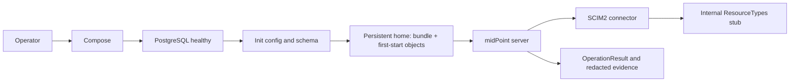

# Phase 1: midPoint platform and connector spike - Research

**Researched:** 2026-10-13
**Domain:** midPoint native repository deployment and community ConnId SCIM2 discovery
**Confidence:** MEDIUM (primary sources and pinned-image inspection; live compatibility awaits execution)

<user_constraints>
## User Constraints (from CONTEXT.md)

The following decisions, discretion and deferrals are copied verbatim. The Orchestrator overrides supersede the original P1-07/P1-14/P1-15/P1-17 text.

## Implementation Decisions

### Pinned platform and source build

- **P1-01:** Pin the final image to evolveum/midpoint:4.8.14-alpine, never latest. Docker Hub's exact-tag API returned this tag on 2026-10-13 with digest sha256:36d443167d9fe9b429e6257c253360d72998d886b8299a0e407af05e01a0e1da. This proves tag availability, not runtime compatibility.
- **P1-02:** Extend docker/docker-compose.yaml, keeping project idp, Keycloak 26.6.1, ClamAV and existing volume identities. Add midpoint_data (postgres:16-alpine), midpoint_init (one-shot), midpoint_server and Mailpit. No pgadmin, Samba AD or HR database.
- **P1-03:** PostgreSQL health precedes init; successful init precedes server startup. Follow the native-repository pattern: midpoint.sh init-native, Ninja repository/audit SQL initialization, then midpoint.sh container. Init and server share midpoint_home at /opt/midpoint/var and consistent MP_SET_midpoint_repository_* settings. Repeated init must handle an existing repository without masking real errors.
- **P1-04:** midPoint binds 127.0.0.1:8081; Keycloak stays on 127.0.0.1:8080 and ClamAV on 127.0.0.1:3310. Keep PostgreSQL internal. Mailpit exposes SMTP internally as mailpit:1025 and the inbox on 127.0.0.1:8025. Research selects a verified fixed Mailpit release. Set-password email integration remains Phase 5.
- **P1-05:** docker/midpoint/Dockerfile builds connector-scim2 tag V1.2.9 from source in a JDK 11 stage using its Gradle 7.2 wrapper; project_version is 1.2.9. Build the fat JAR including runtime dependencies, not the thin JAR, and install it in /opt/midpoint/var/connid-connectors/. Commit no binaries.
- **P1-06:** Account for the upstream plugin/dependency repositories at https://us-east1-maven.pkg.dev/provision-general-operations/provision-public and https://nexus.evolveum.com/nexus/content/repositories/releases/. Upstream uses dynamic dependency suffixes and a time-derived build number. Research must select a stable build number and record resolved dependencies; a source tag alone does not imply bit-for-bit reproducibility. Do not silently upgrade the connector or wrapper.
- **P1-07:** Research must ensure the connector remains installed when midpoint_home masks the image's var directory, including reused volumes. Choose the smallest reliable installation/initialization mechanism.

### Stub and compatibility gate

- **P1-08:** Use a tiny static HTTP container in opt-in compose profile scim-spike, with fixtures/configuration under docker/midpoint/scim-stub/. Research selects a fixed lightweight image. Serve /scim/v2/ResourceTypes as application/scim+json. No host port; midPoint connects by compose service DNS. Normal startup does not need the stub.
- **P1-09:** The fixture is a SCIM ListResponse listing User and Group ResourceTypes, correct core schema URNs, /Users and /Groups endpoints, and list metadata. No provisioning writes, backend endpoints or token issuer. Add other static discovery fixtures only if the real connection-test path requires them. This is a disposable discovery stub, not a production API.
- **P1-10:** Add a clearly named numbered spike object, such as 110-resource-scim-spike.xml, with a stable resource OID and connector lookup by type com.exclamationlabs.connid.base.scim2.Scim2Connector and version 1.2.9, not a machine-specific connector OID. Enable the standard schema; required bearer-token values come from ignored local runtime configuration. Keep this resource separate from Phase 4's IdamBox resource.
- **P1-11:** Preserve the future host bridge: midPoint reaches Strapi at host.docker.internal:1337 with extra_hosts host.docker.internal:host-gateway. No midPoint-to-Keycloak provisioning writer.
- **P1-12:** Go requires the running midPoint to list the connector and the spike resource to pass its connection test, with an observed ResourceTypes request at the stub. A build or direct HTTP fixture check is insufficient. Record versions, commands, connector identifier, result and redacted logs in phase evidence. No-go blocks Phase 2 and records the failure/fallback in ADR 0006. A custom ConnId connector or midPoint 4.11 SCIMREST requires the operator's fallback choice; no silent switch.

### Credentials and configuration lifecycle

- **P1-13:** Credentials live in git-ignored docker/.env; docker/.env.example contains names, explanations and non-secret placeholders. Fail clearly on missing required values. Use one repository credential set across PostgreSQL/init/server. Move hard-coded compose bootstrap credentials to env variables. Never track passwords, bearer tokens, connector binaries or secret-bearing rendered objects/logs.
- **P1-14:** Existing realm import/README contain local passwords and client-secret defaults. The roadmap's no-tracked-credential criterion requires the plan to address these explicitly through environment-backed runtime materialization under ignored docker/ paths, preserving realm/client IDs, redirect URLs, test identities and existing development sign-in behavior. No backend changes. Document that changing env values does not rotate already persisted credentials.
- **P1-15:** Numbered objects under docker/midpoint/objects/ are mounted read-write as /opt/midpoint/var/post-initial-objects/. Stable OIDs and ascending three-digit prefixes define import/overwrite order. Only minimum spike configuration is created now; HR mappings/tasks remain Phase 4.
- **P1-16:** reload.sh and reload.ps1 locate paths from their own location/repository, not the caller's working directory. Explicitly import with Ninja overwrite, in numeric order, accepting both .xml and startup-renamed .xml.done files. Stop on import failure with a nonzero exit code. Restart alone is not reload.
- **P1-17:** Ignore *.done and generated runtime material within docker/. Startup on a read-write bind mount renames host source files; reload/reset must preserve or restore canonical numbered filenames. Document restoration before fresh import: docker compose down -v does not restore host files. Use local rename/copy logic, never destructive git reset.
- **P1-18:** docker/README.md covers env setup, one-command normal startup, opt-in spike startup/test, readiness/logs, both reload scripts, stop preserving state and clean reset. Reset uses docker compose down -v and restores import filenames. Explain removal of Keycloak, midPoint repository/home and ClamAV signatures, and persisted credential reset/rotation behavior.

### ADRs and evidence

- **P1-19:** Brief “ADR 1” and “ADR 3” are local labels. Allocate docs/adr/0005-midpoint-identity-engine-and-strapi-scim.md for D1/D2 and docs/adr/0006-midpoint-lts-and-community-scim2-connector.md for D9/D10 and the compatibility risk. Existing ADRs 0001-0004 remain intact; ADR 0002's outbox amendment belongs to Phase 2.
- **P1-20:** ADR 0005 establishes midPoint as the identity engine, Strapi SCIM as the only inbound provisioning contract, and Strapi as the sole Keycloak provisioning writer. The 2026-10-03 lifecycle brief already has a superseded notice; preserve it and link its replacement.
- **P1-21:** ADR 0006 records pinned versions, primary-source license/support facts without a legal opinion, community-support risk, actual go/no-go result and fallback. Recheck official license/support references during research; sample XML is not compatibility evidence.
- **P1-22:** Subsequent execution verifies every Phase 1 roadmap criterion and runs the mandatory pnpm --dir apps/backend test gate despite no backend changes. No live result or Phase 1 completion is claimed during discussion.
- **P1-23:** Plain conventional commits; no tool/model attribution, co-author trailers or generation notices in files or commits.

### Orchestrator overrides (2026-10-13, supersede the decisions they name)

- **P1-14 narrowed.** "No credential tracked by git" applies to the credentials this phase introduces (midPoint repository, midPoint administrator, any stub token) and to the Keycloak bootstrap admin in `docker/docker-compose.yaml`, which moves to `docker/.env` with the same local default documented in `docker/.env.example`. The Keycloak realm import (`docker/keycloak/import/idambox-realm.json`), its test users and client secrets, and their README tables stay unchanged: they are the documented local-only fixtures that `apps/backend/.env.example`, the CSRM development sign-in and ADR 0004's fixed ids depend on, and the realm seed changes only when a phase needs it.
- **P1-15/P1-17 replaced (deviation from D23's read-write bind mount).** midPoint renames each loaded post-initial object to `*.done`, so a read-write bind of `docker/midpoint/objects/` would rename tracked files and dirty the working tree on every first start. Instead mount `docker/midpoint/objects/` read-only (e.g. `/opt/midpoint/objects-src`); the init service copies the numbered objects into `/opt/midpoint/var/post-initial-objects/` inside the `midpoint_home` volume when the repository is first created; the reload scripts import from the read-only mount with `ninja import --overwrite`. Repository files are never renamed, so no filename restoration logic is needed; `*.done` is still git-ignored as a safeguard.
- **P1-07 direction.** Keep the built connector bundle at an image path outside `/opt/midpoint/var` and have the init service (which runs on every `docker compose up`) copy it into `/opt/midpoint/var/connid-connectors/`, replacing older copies, so a reused `midpoint_home` volume always carries the image's connector. Verified on 2026-10-13: `gradle fatJar` (JDK 11, Gradle 7.2, cloned into a directory named `connector-scim2`, `BUILD_NUMBER=0`) produces `connector-scim2-1.2.9-0-fat.jar` (~27 MB, 41 bundled libs, manifest `ConnectorBundle-Name: connector-scim2`, `ConnectorBundle-Version: 1.2.9`); the project name comes from the clone directory name.
- **Mailpit** pin: `axllent/mailpit:v1.31.5` (pulled 2026-10-13).

### Implementation Discretion

Exact health checks, fixed auxiliary image releases, secure runtime materialization, stable build number and Ninja flags are research/planning choices. Resolve them against pinned sources without routine human questions. Explicitly test clean and reused volumes, repeated init, reload after .done renames and reset during execution.

## Deferred Ideas

- Identity model, tokens, service identities and leaver-safe outbox: Phases 2-3.
- Real SCIM endpoints and recorded request replay: Phase 3.
- CSV, correlation, mappings and lifecycle/reconciliation/refresh tasks: Phase 4.
- Set-password email and end-to-end sign-in: Phase 5.
- Alternative connector/framework implementation: only after recorded no-go and operator fallback choice.
</user_constraints>

<phase_requirements>
## Phase Requirements

Requirement wording is authoritative in REQUIREMENTS.md, Platform section. [CITED: .planning/workstreams/iam/REQUIREMENTS.md]

| ID | Required behavior | Research support |
|---|---|---|
| PLAT-01 | One idp project starts pinned midPoint, native PostgreSQL and Mailpit with ignored credentials and loopback console | Native initialization, credential mapping, lifecycle and health gates below |
| PLAT-02 | Source-built V1.2.9 bundle is available in running midPoint | Fat bundle placement, connector list and real resource test |
| PLAT-03 | Reload, reset and README make configuration reproducible | Read-only source mount, sorted Ninja import and clean/reused-volume checks |
</phase_requirements>

## Summary

Use the existing compose project and the locked pins. Build the SCIM2 fat bundle in a JDK 11 stage, preserve it outside the persisted home, and refresh its installed copy on every init. Copy source objects into the home only when creating the repository. This resolves volume masking and tracked-file rename problems without changing the realm fixture. [CITED: 01-CONTEXT.md, Orchestrator overrides]

The source and image establish usable commands; they do not establish connector compatibility. Execution must separately list the connector from running midPoint, invoke its resource connection test, inspect the OperationResult, and observe the resulting ResourceTypes request at the stub. The go/no-go evidence belongs in ADR 0006. [CITED: 01-CONTEXT.md P1-12/P1-21]

**Primary recommendation:** Three small sequential slices: image/platform foundation; real discovery spike; lifecycle verification and architecture/risk documentation.

## Architectural Responsibility Map

| Capability | Primary tier | Secondary tier | Rationale |
|---|---|---|---|
| Repository initialization and connector installation | Deployment/init | PostgreSQL and persistent home | Init prepares the runtime before server startup |
| Connector execution and resource test | midPoint server | Internal discovery stub | Only the actual ConnId client proves the spike |
| Reload/reset | Deployment tooling | Native repository | Configuration lifecycle belongs beside compose |
| Production provisioning | Strapi backend, later phases | Keycloak sole outbound writer | Phase 1 adds no production SCIM route |

This map applies the brief's D1/D2/D4/D5 boundaries. [CITED: .planning/workstreams/iam/IDENTITY-PROVISIONING-BRIEF.md]

## Project Constraints (from AGENTS.md)

- Preserve Strapi as production API boundary; no frontend facade or raw page fetches.
- Keycloak authenticates; Strapi enforces Role → Function → FunctionAPI and record authorization; navigation is not security.
- Requestor remains implicit; Security Analyst explicit. Advisory output cannot release assessments.
- Preserve JDL terminology; document contract/model gaps rather than inventing entities.
- Add automated tests for material workflows; dependencies need a concrete reason; prefer maintainability.
- Never commit secrets, move node_modules or merge nested backend history.
- Use strict TypeScript, reusable feature modules, semantic tokens, shadcn primitives and responsive accessible UI when frontend scope applies. No frontend changes in this phase.
- Apply shared-backend and portable-document rules from root planning; use root glossary and sequential ADRs.

Source: opened AGENTS.md and root planning/domain references this session. [CITED: AGENTS.md; .planning/PROJECT.md; docs/agents/domain.md]

## Standard Stack

| Component | Pin / build selection | Evidence |
|---|---|---|
| Runtime | evolveum/midpoint:4.8.14-alpine | Inspected image digest sha256:36d443167d9fe9b429e6257c253360d72998d886b8299a0e407af05e01a0e1da; scripts below [VERIFIED: pinned Docker image inspection] |
| Native repository | postgres:16-alpine | Locked D5; 4.8 release docs explicitly recommend PostgreSQL 16 [CITED: https://docs.evolveum.com/midpoint/release/4.8/] |
| Mail sink | axllent/mailpit:v1.31.5 | Locked override [CITED: 01-CONTEXT.md] |
| Discovery stub | nginx:1.28.0-alpine | Pulled and inspected nginx/1.28.0; digest sha256:30f1c0d78e0ad60901648be663a710bdadf19e4c10ac6782c235200619158284 [VERIFIED: official nginx Docker image inspection] |
| Build | gradle:7.2-jdk11, upstream Gradle wrapper 7.2 | Official image manifest verified; wrapper distribution gradle-7.2-bin.zip; preserve wrapper [VERIFIED: Docker manifest and V1.2.9 gradle/wrapper/gradle-wrapper.properties] |
| Connector | V1.2.9, BUILD_NUMBER=0 | Source commit 05c404bbecf9c28938e2183411c7b04b4f8f4226; project_version=1.2.9 [VERIFIED: pinned source clone] |

### Package Legitimacy Audit

No new npm/PyPI/crates package is required. Existing wrapper and Maven dependencies are source-defined; do not add a package manager dependency to serve static discovery. Build provenance is addressed by pinning the source SHA, preserving wrapper, fixed BUILD_NUMBER and saving resolved Gradle buildEnvironment/runtimeClasspath reports in redacted evidence. [CITED: upstream pinned build.gradle]

Dynamic dependencies remain in upstream: connector-base-config-plugin uses 3.0.5-+, connector-base uses 4.1.11-+, and test support uses 3.0.1-+. A fixed source tag/build number does not pin these resolutions. Record actual resolved versions during the image build; pin the selected dynamic artifacts or commit dependency locks under docker/midpoint/ if reproducibility is promised. Do not claim byte-identical output without proving it. [VERIFIED: V1.2.9 build.gradle and gradle.properties]

## Architecture Patterns



Proposed source layout (planning choices, not existing-path claims): docker/midpoint/Dockerfile, init.sh, objects/110-resource-scim-spike.xml, reload.sh, reload.ps1, verify.ps1, scim-stub/nginx.conf and ResourceTypes.json. Documentation remains docker/README.md, docs/adr/0005-midpoint-identity-engine-and-strapi-scim.md and docs/adr/0006-midpoint-lts-and-community-scim2-connector.md.

### Native init and repeatability

Pinned midpoint.sh accepts init-native and container. init-native copies config-native.xml only when config.xml is absent and MP_INIT_CFG is set. It does not itself create a database schema. Set MP_INIT_CFG=/opt/midpoint/var and share the home. Use identical repository settings on init/server: MP_SET_midpoint_repository_jdbcUrl, jdbcUsername, jdbcPassword and database; config-native.xml supplies repository type native and native audit service. [VERIFIED: pinned image /opt/midpoint/bin/midpoint.sh and doc/config/config-native.xml]

Use PostgreSQL health check pg_isready with the configured user/database; condition service_healthy → init, service_completed_successfully → server. Fail missing required env using Compose interpolation ${VARIABLE:?message}. Avoid printing docker compose config output because it expands secrets; use config --quiet. [CITED: https://docs.docker.com/compose/how-tos/startup-order/; https://docs.docker.com/compose/how-tos/environment-variables/variable-interpolation/]

Do not use grep ERROR as the repository existence test. Ninja info can catch errors while returning normally; its result text includes repository test status. Use a positive database schema probe. Smallest robust implementation: add postgresql16-client to the runtime image for the init script, then authenticated psql with ON_ERROR_STOP=1 and a scalar query checking public.m_global_metadata/public.m_object. Probe repository and audit independently. Create REPOSITORY then AUDIT only for absent schema; partial schema or connection/authentication failures stop init. Finish with Ninja info and explicitly require Repository test: SUCCESS. [VERIFIED: pinned InfoRepositoryAction.java; pinned native SQL and image apk policy showing postgresql16-client 16.15-r0]

Copy the immutable bundled JAR from a proposed image path /opt/midpoint/connector-bundle/ into home connid-connectors on every init; remove only prior copies matching connector-scim2-*-fat.jar, then copy the current bundle. Never rely on image var content under a reused volume. Only fresh repository creation seeds post-initial-objects from objects-src. Copying must follow successful schema creation and precede server launch. [CITED: 01-CONTEXT.md override]

Use MP_SET_midpoint_administrator_initialPassword on server, required from ignored env. The exact key is midpoint.administrator.initialPassword. Pinned DataImport creates/logs a generated password when absent; explicitly setting it prevents that path. Existing administrator passwords are not rotated by changing env. Never enable printSensitiveValues. [VERIFIED: v4.8.14 infra/common MidpointConfiguration.java:53; gui/admin-gui init/DataImport.java:129-149; repo/system-init StartupConfiguration.java]

### Source-built bundle

Clone into a directory named connector-scim2. Execute BUILD_NUMBER=0 ./gradlew --no-daemon fatJar (wrapper JDK 11). fatJar includes custom/lib dependencies while excluding connector-framework jars; thinJar is insufficient. Save buildEnvironment and dependencies --configuration runtimeClasspath reports, inspect META-INF/MANIFEST.MF and lib/ entries, and copy only the fat artifact to the final stage. The override already records the expected connector-scim2-1.2.9-0-fat.jar, 41 libs, bundle version 1.2.9; confirm during execution. [VERIFIED: pinned build.gradle; CITED: 01-CONTEXT.md override]

### Minimal discovery and token handling

Configure nginx with an exact location /scim/v2/ResourceTypes, application/scim+json, a static fixture, and access logging of method/path/status only (never Authorization). Reject unknown paths/writes. Keep no host port. Healthcheck with wget --spider on the fixture. Both nginx and midpoint images contain wget. [VERIFIED: inspected official images; planning recommendation]

Fixture: ListResponse schema urn:ietf:params:scim:api:messages:2.0:ListResponse, totalResults=2, startIndex=1, itemsPerPage=2, ResourceType entries name/id User and Group, endpoints /Users and /Groups, respective core User/Group schema URNs. The test driver reads resource names only; standard schema adapters avoid dynamic discovery. Add other fixtures only after a recorded actual request requires them. [VERIFIED: V1.2.9 Scim2Driver.java:52-84 and configuration.structure.yml; CITED: https://www.rfc-editor.org/rfc/rfc7643; https://www.rfc-editor.org/rfc/rfc7644]

Use exact config namespace http://midpoint.evolveum.com/xml/ns/public/connector/icf-1/bundle/connector-scim2/com.exclamationlabs.connid.base.scim2.Scim2Connector and fields serviceUrl, token, enableStandardSchema=true, enableEnterpriseUser=false, enableAWSSchema=false, enableSlackSchema=false, enableDynamicSchema=false, deepGet=false, deepImport=false, usersEndpointUrl=/Users and groupsEndpointUrl=/Groups. Avoid the AWS sample's OID/version/roles/schema. [VERIFIED: upstream artifacts/post-initial-objects/resources/AWS-SCIM2-Resource.xml and configuration.structure.yml]

To keep tracked objects secret-free, prefer a token configuration expression reading the SCIM_SPIKE_TOKEN process environment, with the variable supplied only through ignored .env. Configuration-property expressions are officially supported. Confirm the expression resolves against the connector's generated token type during the live gate; if unavailable, materialize a token-bearing copy only inside the home/ignored runtime using XML escaping. Never put a literal token in source objects or evidence. [CITED: https://docs.evolveum.com/midpoint/reference/master/expressions/constants/configuration/; planning decision]

### Reload

Pinned Ninja syntax is /opt/midpoint/bin/ninja.sh -B import --overwrite --input FILE. Read-only objects-src stays canonical; import each numbered file separately in lexical/numeric order and fail on errors. PostInitialDataImport renames loaded volume copies to .done, not read-only sources. Ninja writes repository directly, so after successful imports restart midpoint_server to avoid cached resource data, then verify changed description via REST and rerun the test. Restart without import is insufficient. [VERIFIED: pinned Ninja help; v4.8.14 PostInitialDataImport.java; planning cache precaution]

## Don't Hand-Roll

| Problem | Use |
|---|---|
| Repository/audit schema | Distribution SQL through Ninja run-sql |
| Connector bundle format | Upstream fatJar |
| Discovery responder | Static nginx exact route |
| Runtime verification | Actual midPoint REST test and OperationResult |
| XML/secret materialization when needed | XML parser/serializer, never unescaped replacements |

These are recommendations grounded in the pinned source and the locked boundary; no production SCIM or custom ConnId implementation belongs in the spike.

## Common Pitfalls

- Image var content disappears under the home volume; refresh bundle from an outside image path each init.
- Existing repository does not mean audit exists; test both and reject partial schema.
- Ninja command errors may appear in logs; enforce result/exit checks, not exit alone.
- Default generated administrator password can leak in logs when its setting is absent.
- A connection test can respond HTTP 200 with unsuccessful OperationResult; inspect status.
- RequestTypes direct HTTP curl is not the connector go gate; tie stub logs to the midPoint POST test.
- Full resource dumps may carry token/configuration secrets; project connector fields and operation status only.
- down -v removes Keycloak state, repository/home and ClamAV signatures; it does not alter canonical source objects.
- Changing env credentials does not rotate persisted accounts.
- Source-level success, manifest correctness and upstream sample XML are not compatibility proof.

[VERIFIED: pinned inspected scripts/controllers/importer; CITED: 01-CONTEXT.md]

## Code Examples: verified CLI contract

Commands below are future execution verification, not results from this planning run. Run from repository root; explicit compose flags locate ignored env consistently.

```powershell
docker compose --env-file docker/.env -f docker/docker-compose.yaml config --quiet
docker compose --env-file docker/.env -f docker/docker-compose.yaml build midpoint_init midpoint_server
docker compose --env-file docker/.env -f docker/docker-compose.yaml up -d
docker compose --env-file docker/.env -f docker/docker-compose.yaml ps -a
docker compose --env-file docker/.env -f docker/docker-compose.yaml exec -T midpoint_server /opt/midpoint/bin/ninja.sh -B info
docker compose --env-file docker/.env -f docker/docker-compose.yaml --profile scim-spike up -d
pwsh -NoProfile -File docker/midpoint/verify.ps1 -Mode Spike
pwsh -NoProfile -File docker/midpoint/reload.ps1
bash docker/midpoint/reload.sh
pwsh -NoProfile -File docker/midpoint/verify.ps1 -Mode Reload
docker compose --env-file docker/.env -f docker/docker-compose.yaml down
docker compose --env-file docker/.env -f docker/docker-compose.yaml --profile scim-spike up -d
pwsh -NoProfile -File docker/midpoint/verify.ps1 -Mode Reused
docker compose --env-file docker/.env -f docker/docker-compose.yaml --profile scim-spike down -v
docker compose --env-file docker/.env -f docker/docker-compose.yaml --profile scim-spike up -d
pwsh -NoProfile -File docker/midpoint/verify.ps1 -Mode Reset
pnpm --dir apps/backend test
```

The proposed verify.ps1 is a bounded phase-owned verification helper, not an existing tool. Planner must create it or inline equivalent commands. It safely parses local env without executing dotenv as code, derives administrator Basic header in memory, never echoes it, and calls:

```powershell
$connectors = Invoke-RestMethod -Uri 'http://127.0.0.1:8081/midpoint/ws/rest/connectors' -Headers $headers
$result = Invoke-RestMethod -Method Post -Uri 'http://127.0.0.1:8081/midpoint/ws/rest/resources/11000000-0000-4000-8000-000000000001/test' -Headers $headers
if ($result.object.status -ne 'success') { throw 'SCIM spike resource test failed' }
docker compose --env-file docker/.env -f docker/docker-compose.yaml logs --since 2m scim_stub
```

11000000-0000-4000-8000-000000000001 is a proposed stable spike OID; use it consistently in object and helper. $headers is supplied internally from the ignored administrator credential, not printed. Assert exactly one connector with connectorType com.exclamationlabs.connid.base.scim2.Scim2Connector and connectorVersion 1.2.9. Assert stub log records GET /scim/v2/ResourceTypes with successful status after that POST. Do not serialize the full connector/resource response. [VERIFIED: v4.8.14 ModelRestController.java:695-718; CITED: https://docs.evolveum.com/midpoint/reference/support-4.8/interfaces/rest/operations/]

Exact initialization/import commands (inside init/reload):

```bash
/opt/midpoint/bin/midpoint.sh init-native
/opt/midpoint/bin/ninja.sh -B run-sql --create --mode REPOSITORY
/opt/midpoint/bin/ninja.sh -B run-sql --create --mode AUDIT
/opt/midpoint/bin/ninja.sh -B import --overwrite --input /opt/midpoint/objects-src/110-resource-scim-spike.xml
```

[VERIFIED: pinned image help and midpoint.sh inspected this session]

## Environment Availability

| Dependency | Available | Observation |
|---|---|---|
| Docker engine | yes | 28.4.0, pinned midPoint image runnable |
| Docker Compose | yes | v2.39.2-desktop.1 |
| Node | yes | v24.21.0 |
| pnpm | yes | 11.24.0 |
| Git/network | yes | Pinned upstream clones and image pull completed |
| psql in base midPoint | no observed executable | Add postgresql16-client for robust init probe |

[VERIFIED: this session CLI/image probes] No environment blocker was found. Compatibility remains an execution gate, not an environment blocker.

## Validation Architecture

Nyquist is enabled in root config. Existing backend test script uses TypeScript compilation and node --test; Phase 1 adds deployment smoke assertions under docker/, with no midPoint in CI. [CITED: .planning/config.json; apps/backend/package.json scripts.test; brief D18]

| Requirement | Test type | Exact gate |
|---|---|---|
| PLAT-01 | Compose static + live smoke | config --quiet; build; up; ps; bounded readiness and Ninja info |
| PLAT-02 | Actual connector integration | verify.ps1 -Mode Spike, connector type/version + resource success + stub request |
| PLAT-03 | Configuration lifecycle | reload scripts + REST description assertion; reused and reset modes |
| Every phase | Regression suite | pnpm --dir apps/backend test |

Per-task quick checks: compose config --quiet, bash -n docker/midpoint/init.sh docker/midpoint/reload.sh, and PowerShell parser checks for script syntax. Per-wave: relevant live smoke mode once its slice exists. Phase gate: full fresh/reused/reload/reset sequence and backend suite green.

Wave 0 gaps: future verification helper and its bounded readiness/status assertions; deterministic redacted evidence format. Do not add a new test framework. Full Docker startup/build/backend suite exceed 30 seconds; mark them integration/phase gates, not pretend quick unit checks. Canonical source filename preservation should be asserted with git status --short -- docker/midpoint/objects after startup/reload/reset.

## Security Domain

Use ASVS 4.0-style category names as a review taxonomy, not certification. Applicable controls: V2 authentication (explicit bootstrap credentials); V3 session management (reuse platform, no custom code); V4 access control (loopback/internal-only services); V5 input validation (XML escaping/static routing/env validation); V6 cryptography (platform protection, no custom cryptography). [CITED: https://owasp.org/www-project-application-security-verification-standard/; scope recommendation]

Threats: secret leakage through rendered compose/logs; unauthenticated exposed stub; initialization errors mistaken for fresh state; two Keycloak provisioning writers. Mitigate with quiet config, redacted evidence, no stub host port, fail-closed schema probes, and unchanged writer boundary. These are phase-specific recommendations grounded in the brief/overrides.

## State of the Art

midPoint 4.8 is the explicitly selected LTS, not a recommendation to silently upgrade. Official release matrix lists support to 17 October 2028. Release docs state dual Apache/EUPL licensing and native PostgreSQL support. Provision IAM connector is community support; its source README states Apache-2.0. Record these facts with source links and no legal conclusion in ADR 0006. [CITED: https://docs.evolveum.com/midpoint/release/; https://docs.evolveum.com/midpoint/release/4.8/; https://docs.evolveum.com/connectors/connectors/com.exclamationlabs.connid.base.scim2.Scim2Connector/; https://github.com/ExclamationLabs/connector-scim2/blob/V1.2.9/README.md]

## Assumptions Log / Open Questions

No unresolved decision requires human input. Live outcomes are deliberately unknown: connector load/runtime compatibility, env-token expression type conversion, fresh/reused initialization and reload cache behavior. Plans must test these rather than label them supported from sample/source inspection. On actual no-go, record failure and stop later phases; operator fallback selection remains outside this non-interactive planning run. [CITED: 01-CONTEXT.md P1-12]

Exact resolved dynamic Maven versions have not been measured by this researcher; capture them in the build evidence and lock selected resolutions where needed. Do not invent them. The token expression has documentation support but no live validation here; the ignored-volume XML materialization fallback remains within the authorized scope.

## Sources and Research Method

Primary sources consulted:
- Pinned runtime image and /opt/midpoint/bin/midpoint.sh, ninja.sh, native config/SQL, including actual help commands.
- [Pinned connector source](https://github.com/ExclamationLabs/connector-scim2/tree/V1.2.9), commit 05c404bbecf9c28938e2183411c7b04b4f8f4226: build.gradle, gradle.properties, wrapper, configuration.structure.yml, Scim2Driver and AWS sample.
- [Pinned midPoint source](https://github.com/Evolveum/midpoint/tree/v4.8.14), commit c3393958d5c4bfdd19bea406eebdfc382742fd22: ModelRestController, DataImport, PostInitialDataImport, MidpointConfiguration, StartupConfiguration and Ninja InfoRepositoryAction.
- Official Evolveum, Docker and IETF documentation linked adjacent to findings.

Pinned image/source observations are distinguished from runtime compatibility evidence. Canonical phase references, including unchanged realm fixtures and early research, inform scope; they do not prove runtime compatibility.

**Valid until:** Recheck pinned image/dependency resolution at execution; architecture constraints remain locked.

