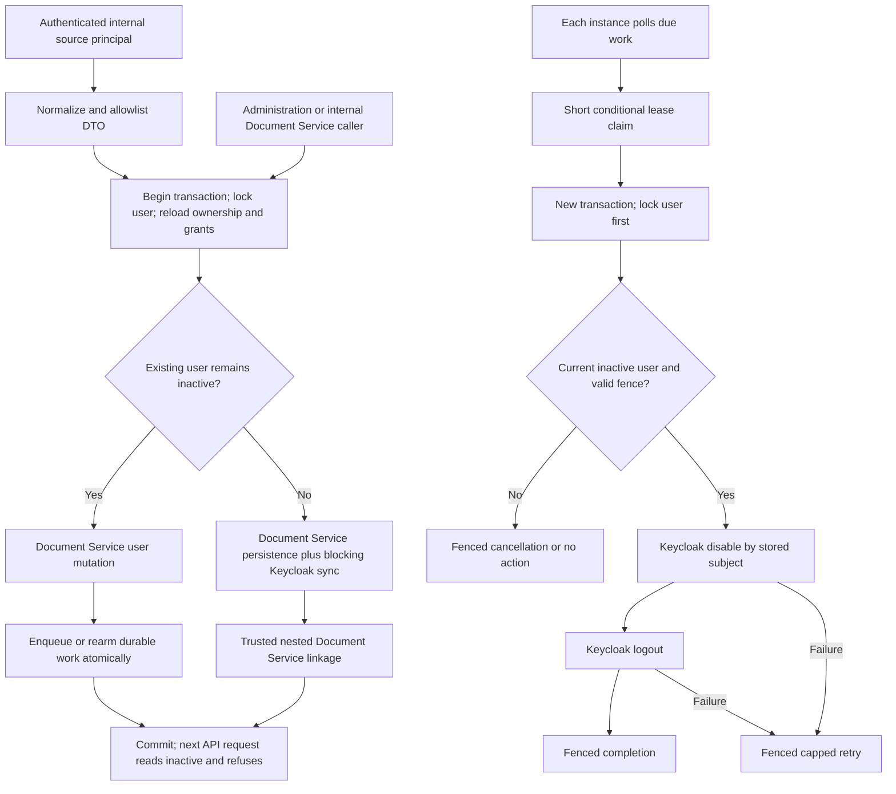

# Phase 2: Identity model and leaver-safe Keycloak sync - Research

**Researched:** 2026-10-14
**Domain:** Shared Strapi identity ownership, transactional deactivation and durable Keycloak revocation
**Confidence:** MEDIUM

<user_constraints>
## User Constraints (from CONTEXT.md)

The following locked material is copied verbatim. The later operator instructions below supersede its approval-pending and discussion-only statements. [VERIFIED: .planning/workstreams/iam/phases/02-identity-model-and-leaver-safe-keycloak-sync/02-CONTEXT.md:21-117]

### Locked Decisions

<!-- DATA_93ed6a12_START -->
### Approval and naming

- **P2-01:** The first execution plan must first create or reconcile docs/contract-gaps/iam-identity-model-and-leaver-sync.md, then stop at an operator approval checkpoint before any content-type, generated content-type declaration, schema-sync boot or data migration. Approval is pending, cannot be auto-selected, and must identify the exact reviewed record revision. A later schema change to the proposal needs renewed approval. Name iam and csrm as affected workstreams; csrm reads IdamBoxUser throughout requests, questionnaires, assessments, risks and people selectors. Do not silently mark approval as received.
- **P2-02:** JDL defines IdamBoxUser, Role, Function, FunctionApi, username, firstName, lastName, displayName, accountStatus and externalSubject. It contains neither IdentitySource nor KeycloakSyncOutbox nor the new source fields. Record these as additive contract gaps, not as existing JDL entities. Use FunctionApi in schema/entity terminology and Role → Function → FunctionAPI in capability prose. Do not rewrite the frozen JDL as a side effect. Amend ADR 0002 only during approved implementation; preserve its off-by-default and blocking-create/update decisions.

### Exact schema proposal

- **P2-03:** IdentitySource: UID api::identity-source.identity-source, collection identity_sources, singular identity-source, plural identity-sources, display name Identity Source. draftAndPublish false, no localization. Built-in id, documentId, createdAt and updatedAt remain Strapi-owned.

| Field | Strapi type | Constraints and meaning |
| --- | --- | --- |
| name | string | Required, unique, maxLength 255; trimmed nonblank source label. |
| sourceStatus | enumeration | Required, active or inactive, default active; inactive refuses provisioning. |
| serviceUser | relation oneToOne to api::idambox-user.idambox-user | Required, one-way; database uniqueness of target relation must be verified. |
| tokenHash | string | Optional, private, maxLength 255; null means no token/revoked; never plaintext. |
| tokenRotatedAt | datetime | Optional, private, UTC; latest issuance, rotation or revocation time. |
| lastActivityAt | datetime | Optional, UTC; latest authenticated source request. |

- **P2-04:** Add these attributes to the existing api::idambox-user.idambox-user / idambox_users, preserving all existing field types, requiredness, global email/username/externalSubject uniqueness and roles relations.

| Field | Strapi type | Constraints and meaning |
| --- | --- | --- |
| identitySource | relation manyToOne to api::identity-source.identity-source | Optional, one-way; null means manual. No inverse field. |
| sourceExternalId | string | Optional, maxLength 255; opaque, case-sensitive, nonblank when sourced; NOT globally unique. |
| sourceIdentityKey | string | Optional, private, unique, minLength/maxLength 64; server-derived SHA-256 hex of UTF-8 JSON.stringify([identitySource.documentId, sourceExternalId]). Null for manual users. |
| employeeNumber | string | Optional, maxLength 255; matching information, not unique and not an ownership key. |
| department | string | Optional, maxLength 255. |
| jobTitle | string | Optional, maxLength 255; SCIM title maps here. |
| sourceDeletedAt | datetime | Optional, UTC tombstone; does not erase ownership. |
| lastSyncedAt | datetime | Optional, UTC; latest accepted source mutation, including idempotent replay. |
| protected | boolean | Required, default false; existing rows read false. Blocks every source read, claim and mutation. |

- **P2-05:** A user is either manual (identitySource, sourceExternalId and sourceIdentityKey all null) or sourced (all present). Reject partial tuples. Preserve sourceExternalId verbatim: no trimming, case folding or numeric coercion; reject empty/whitespace-only or overlong values. A source and its key are immutable after claim. Deleted/inactive users retain the tuple and its uniqueness reservation. Another source may use the same external id but global email and username uniqueness still applies. Preflight is only a friendly error; the database unique index on sourceIdentityKey arbitrates races. Compute the key in middleware from the persisted source documentId and validated external key, never caller input. On constraint conflict compare the actual tuple and refuse; never adopt a different tuple because of a hash match. Verify the actual index after fresh and reused schema sync. This private technical field is part of the approval proposal, not a new domain entity. Case-sensitive hash input avoids database text-collation differences.
- **P2-06:** KeycloakSyncOutbox: UID api::keycloak-sync-outbox.keycloak-sync-outbox, collection keycloak_sync_outboxes, singular keycloak-sync-outbox, plural keycloak-sync-outboxes, display name Keycloak Sync Outbox. draftAndPublish false, no localization; internal-only, no core content API routes or public permissions.

| Field | Strapi type | Constraints and meaning |
| --- | --- | --- |
| userDocumentId | string | Required, unique, maxLength 24; stable IdamBoxUser documentId, one durable work row per user. |
| idamboxUser | relation oneToOne to api::idambox-user.idambox-user | Required, one-way; must match userDocumentId. |
| externalSubject | string | Optional, maxLength 255; snapshot of the Keycloak id for this deactivation, never email lookup. |
| operation | enumeration | Required, disableAndEndSessions only. |
| syncStatus | enumeration | Required, pending, processing, completed or cancelled; default pending. |
| generation | integer | Required, default 1, min 1; increments on each new deactivation; no wraparound. |
| attempts | integer | Required, default 0, min 0; increments on a successful claim. |
| lastErrorCode | string | Optional, maxLength 120; closed safe code, never remote body, credentials or personal data. |
| nextAttemptAt | datetime | Required, UTC; due time, initially transaction time. |
| leaseOwner | string | Optional, private, maxLength 36; random UUID for each claim, not an instance name. |
| leaseExpiresAt | datetime | Optional, private, UTC; expiry of the active claim. |
| completedAt | datetime | Optional, UTC; both disable and session termination succeeded, or subject absent. |

The outbox is a durable current-work record, not a lifecycle audit store. Rearm its row under the user lock for a new active-to-inactive transition, increment generation and reset lease/attempt/error/completion fields. Repeated deactivation of the same inactive state neither creates another row nor resets backoff; ensure missing work is enqueued for a linked inactive user. Bounds overflow fails safely and never wraps. Required fields belong only to newly introduced collections; legacy users gain nullable fields and protected=false. No blanket changes to existing status, roles, subjects or references.

### Source service identity and catalogue

- **P2-07:** Each source acts as an ordinary IdamBoxUser: protected=true, identitySource/sourceExternalId/sourceIdentityKey null, accountStatus=active, no password or externalSubject, one explicit Identity Provisioning Role. Derive non-human status from being registered as IdentitySource.serviceUser; do not invent a principal content type, a human boolean or a new use for protected. Protected break-glass people remain people. Only trusted registration/seed code may attach the provisioning Role, and only to a registered protected source service identity. Refuse unprotection or unrelated role grants while registered. Source authentication must re-read active source, active service user, protection, binding and exact grant each request.
- **P2-08:** Both catalogue copies add role.identity_provisioning named Identity Provisioning with exactly function.identity_provisioning.api named Identity Provisioning. The Function belongs to a new seeded Application row, IdamBox IAM (slug idambox-iam, active; only idambox-csrm exists today, and an Application row is seed data, not a content-type change). The Function has no menuPath and no grants to existing roles. Source identities receive no explicit or implicit Requestor/analyst grants. Exclude registered source service identities from the existing unconditional Requestor birthright calculation and person selectors; do not exclude all protected users. Source bearer authentication populates only its provisioning identity context and never the CSRM identity-header context.
- **P2-09:** Reserve FunctionApi entries for GET /scim/v2/Users, POST /scim/v2/Users, GET /scim/v2/Users/{id}, PUT /scim/v2/Users/{id}, PATCH /scim/v2/Users/{id}, DELETE /scim/v2/Users/{id}, GET /scim/v2/ServiceProviderConfig, GET /scim/v2/Schemas, GET /scim/v2/Schemas/{id}, GET /scim/v2/ResourceTypes, GET /scim/v2/ResourceTypes/{id}, GET /scim/v2/Groups and POST/PUT/PATCH/DELETE Group collection/resource operations needed for explicit 501 responses. URLs use the existing METHOD:/path catalogue convention. Phase 2 reserves them as intentionally unserved; Phase 3 catalogs every actually mounted operation and adds traceability for 501 Group responses. Do not mount a FunctionApi just to satisfy a reservation. Existing CSRM grants and endpoints remain backward compatible.
- **P2-10:** Add an idempotent opt-in development source seed under the existing development seed discipline: name midPoint (dev), active, dedicated protected service user username midpoint-dev-provisioning, email midpoint-dev-provisioning@idambox.test, displayName midPoint (dev) provisioning. Refuse collisions with an unrelated user instead of converting them. Persist source and service-user binding atomically; do not reset tokens or overwrite sourced fixture users on restart. Seed no bearer token in Phase 2; tokenHash remains null until Phase 3 tooling. Seed IAM Functions against the IAM Application instead of sending them through the CSRM seed's hard-coded Application assignment.

### Internal service, ownership and claims

- **P2-11:** Add a feature module under apps/backend/src/iam/identity/ with typed internal methods createFromSource, replaceFromSource, patchFromSource, deactivateFromSource, readForSource and listForSource. There is no generic save, raw-database writer, HTTP facade or midPoint-specific API. Inputs use an authenticated SourcePrincipal constructed internally from source/service identity/grants, plus a normalized shared-schema identity DTO. Service methods validate the principal and use Document Service transactions. Read/list project allowlisted fields, never raw populated records or private attributes.
- **P2-12:** The source DTO permits username, email, firstName, lastName, displayName, accountStatus, sourceExternalId, employeeNumber, department and jobTitle. D19 mapping is fixed. It cannot set roles, password, protected, externalSubject, identitySource, sourceIdentityKey, sourceDeletedAt or lastSyncedAt. The latter ownership/timestamp fields are derived by the service. New sourced people have roles=[] and receive Requestor implicitly. Movers/claims preserve explicit IdamBox Roles. Phase 3 translates full PUT replacement of optional source-owned fields and PATCH deltas; neither may erase IdamBox-owned fields. Internal closed outcomes include forbidden, notFound, uniqueness, immutableSourceKey, invalidInput and keycloakUnavailable, with safe details and retryAfterSeconds=30 for transient Keycloak failure. Phase 3 maps them to SCIM/HTTP including 503 and Retry-After: 30; duplicate uniqueness remains 409 and validation 4xx.
- **P2-13:** A source sees its own nonprotected, nontombstoned users plus unowned, unprotected manual users for read-only correlation. Direct foreign/protected/tombstoned reads and mutations answer indistinguishable notFound; filters/counts/pagination must not reveal them. Manual reads omit the nonexistent source externalId. Writes resolve only explicit documentId or an owned source tuple, never silently email/employeeNumber.
- **P2-14:** Only replaceFromSource can claim: an explicit manual target documentId, a nonblank externalId mapped to sourceExternalId, and an authenticated source. The first PUT to that unowned, unprotected user is the confirmed-claim signal under D13. Strapi cannot independently prove a midPoint operator clicked confirmation; that trust boundary is explicit. Do not add a nonstandard claim token/header or a backend confirmation screen. Phase 4 proves the operator-confirmed correlation case. POST conflicts instead of claiming; PATCH and DELETE cannot claim. Under a database user lock, re-read source/protection/tuple, reserve the unique tuple, apply identity changes and timestamp in one transaction. Same-source/key replay becomes an update; another source or another key is refused. Keycloak blocking failure rolls the claim back. Log source, service identity, target and outcome, never credentials.
- **P2-15:** deactivateFromSource accepts only an owned target and a server-selected source-deletion flag. Set inactive; on deletion set sourceDeletedAt once. Tombstoned repeats are idempotent for the owning source, while reads stay hidden. No hard delete. No unclaim/reassignment operation. Restoring a source-deleted user is deferred; do not silently resurrect a tombstone with create or replace.

### Refusal of HR-owned edits

- **P2-16:** Register ownership/field middleware unconditionally in Strapi register, independently of Keycloak flags. Controllers may translate errors, but controller-only enforcement is rejected: the IdamBoxUser core router has only:[], while content-manager and internal Document Service callers bypass that controller. Read the persisted user inside the write transaction, then refuse attempts by ordinary administration to change username, email, firstName, lastName, displayName, accountStatus, employeeNumber, department or jobTitle on a sourced user. Equal-value submissions are allowed as no-ops; any different owned field rejects the whole write before next(). Roles-only edits still succeed. Ownership fields, source timestamps and protection changes require narrowly trusted server operations. For sourced users password and externalSubject are never generic administrative inputs; credentials remain Keycloak-owned.
- **P2-17:** Use a private request-scoped/in-process write context for source operations, source registration and Keycloak linkage write-back. It must be impossible to assert through HTTP data, headers or arbitrary context.params properties. No global boolean, leaked privilege across concurrent promises or public skip-provisioning option. Middleware validates the operation's exact field allowlist and source ownership even with trusted context. Development reseeding skips HR edits of already sourced people rather than impersonating their source. Direct internal Document Service calls without source context cannot edit HR fields.

### Leaver transaction and blocking updates

- **P2-18:** Route all IdamBoxUser creates/updates through a transaction-aware middleware path. On an existing user's update with effective accountStatus=inactive, commit the Document Service change and enqueue/rearm its outbox atomically without a Keycloak lookup, token call or other network I/O. This covers an active-to-inactive transition, inactive replay and a source full PUT containing additional HR changes. It does not create an inactive user asynchronously: all creates still use the blocking path. Outbox failure rolls the whole transaction back; never commit a deactivation with silently lost work. No general catch-and-continue around the blocking provisioner.
- **P2-19:** All creates and non-deactivation updates that require Keycloak retain blocking transaction behavior and rollback on failure. Preserve ADR 0002's linked roles-only/nonmirrored-field skip. An inactive-to-active update is a blocking reactivation. Before enabling, serialize against outbox work and cancel pending old generations in the same transaction; stale workers must not subsequently disable the reactivated user. No Keycloak call for a registered source service identity, which is bearer-only; this exception is derived from the verified registration binding, not protected=true alone.
- **P2-20:** Identity ownership/outbox enqueue remain active when provisioning is off. The worker is inert and creates no client or network call while IDAMBOX_KEYCLOAK_PROVISIONING is false/unset. Pending work stays pending for a later enabled boot. Linked users enqueue a snapshot externalSubject; absence of externalSubject completes as a safe no-op when the worker runs, without creating/adopting a Keycloak user. No email lookup in the leaver worker. Authorization continues to re-read active status per request as ADR 0004 requires; queue availability never controls API refusal.

### Outbox concurrency and retry

- **P2-21:** All instances may poll, but ownership is database-atomic. Select a candidate as a hint, then issue one conditional UPDATE for its id and generation: either pending with nextAttemptAt <= database UTC now, or processing with leaseExpiresAt <= now. Set processing, fresh leaseOwner UUID, leaseExpiresAt, and attempts+1. Proceed only when exactly one row was affected; PostgreSQL may use RETURNING. Never read then perform an unconditional update, never rely on a timer flag or process-local mutex. Use transaction-bound Knex for outbox-only atomic coordination, which is explicitly allowed; it must not become a user-data mutation path.
- **P2-22:** Completion, retry, renewal and cancellation are fenced by row id, generation and leaseOwner. Use database time for eligibility/expiry. Default poll 5 seconds, lease 60 seconds; bound the entire disable/logout attempt to 30 seconds with existing per-call timeouts no greater than 5 seconds, including token refresh/retry. If configuration cannot fit the lease, fail boot or renew atomically before exceeding it. A lost fence cannot acknowledge or reschedule work. Expired leases are recoverable after restart.
- **P2-23:** Claims alone do not prevent a stale disable racing reactivation. Worker and all user writes share a database per-user serialization boundary. PostgreSQL/MySQL use the existing user row lock; the worker revalidates current inactive state, externalSubject, generation and lease after locking, and fences the outbox in that transaction before network calls. Reactivation acquires the same lock before provisioning and cancelling old work. Lock user before outbox for row-lock databases; on SQLite acquire its write transaction lock through conditional outbox coordination before deciding reads, with bounded busy retry. No raw IdamBoxUser mutation to obtain a lock. Research must prove the pinned Strapi transaction binding and dialect behavior; a one-process promise tail or SQLite single-connection test is insufficient evidence of multi-instance safety.
- **P2-24:** Worker sends PUT /admin/realms/{realm}/users/{externalSubject} with enabled=false, then POST /admin/realms/{realm}/users/{externalSubject}/logout. Mark completed only after both succeed; Keycloak 404 is success because there is no user/session to revoke. Retry the whole idempotent pair after partial failure or crash. Backoff = min(3600, 5 * 2^(attempts-1)) seconds with bounded jitter of at most 20%; do not stop permanently after N attempts. Authentication/configuration failures stay pending with capped retry and a safe error log. Store only closed error codes, not remote messages/bodies. Stop timers and await bounded in-flight work in destroy().
- **P2-25:** Promise at-most-one valid lease and concurrent execution per row/generation, not exactly-once remote delivery: a crash after Keycloak success before acknowledgement necessarily causes replay. Keep an executable shared-PostgreSQL two-instance gate with independent Strapi processes/connections, simultaneous claims, forced lease expiry, worker death, stale-owner acknowledgement, partial disable/logout failure, reactivation interleaving and a second leaver generation. Both instances must point to the same backend database; midPoint's repository is unrelated. SQLite tests verify local semantics but cannot substitute for this production gate. Do not claim support for an untested database dialect.

### Document-Service-only rule and verification

- **P2-26:** No application IdamBoxUser write through strapi.db.query, entityService, query builder, raw Knex/SQL, bulk mutation or relation mutation outside Document Service. Reads and SELECT locks are allowed; atomic outbox coordination is allowed. Framework-internal database writes made by Document Service are not violations. Existing query-layer externalSubject/password write-back in register-idambox-user-provisioning.ts must be removed, not broadly allowlisted.
- **P2-27:** Capture and validate a transient manual password before next(), keep it out of persisted input when provisioning is enabled, pass it only to the Keycloak client, and use a nested trusted Document Service update for externalSubject/write-back inside the original transaction. Trusted linkage context may write only externalSubject and password cleanup and skip only recursive external provisioning, never the ownership guard. No plaintext or bcrypt hash persists after a provisioned write. Research must prove password omission/null cleanup under pinned Strapi 5.51 validation; do not assume the current comment that null fails is correct or use query-layer cleanup to avoid investigating it. Retain legacy off-mode behavior and password input validation.
- **P2-28:** Add a TypeScript-AST-based source guard that resolves literal UID/constants and local service aliases, detects database/entityService/raw user writes and rejects unresolved generic mutation helpers on the user path. Add fixture violations for direct query, aliased query, bulk and raw writes so the guard itself is proven. Runtime integration instruments Document Service context and query mutations: low-level user writes are permitted only during validated Document Service persistence, not merely while some user transaction exists. Exercise upsert methods, generic administration/content manager, source registration/seed, blocking linkage and deactivation. A middleware hook counter alone cannot prove no bypass. Negative tests intentionally bypass Document Service and must fail the discipline guard.
- **P2-29:** Use real Strapi transaction tests with the existing fake Keycloak server for rollback, inactive commit with no network calls, durable enqueue, failure between user write/enqueue, retry/logout, source ownership, protected users, duplicate source tuples, concurrent claims, unchanged roles, HR-edit refusal with provisioning off and on, private-field projection, service grants and repeat seeding. Retain Keycloak create/update rollback and password cleanup tests. Prove next-request refusal for an existing signed-in identity after Phase 2 internal deactivation; the SCIM/UI-specific refusal gate remains Phase 3.
- **P2-30:** Run pnpm --dir apps/backend test after approved implementation; record the known pre-existing order-dependent ECONNRESET baseline separately and do not relabel it as a pass. Retain contract/catalogue/served-operation compatibility checks. Confirm schema diff matches the approved gap record and no existing CSRM grants changed. Before execution, merge any backend changes from the default branch that this branch lacks (merge, never rebase) and re-run the plan check; never alter nested history.
<!-- DATA_93ed6a12_END -->

### Implementation discretion

<!-- DATA_caf73614_START -->
Exact module filenames, validation helper reuse, middleware registration arrangement and dialect adapter details may be chosen during research. Locked field names/types, ownership and claim rules, database uniqueness, atomic leases, blocking semantics, Document Service discipline and the approval gate cannot be relaxed. No new dependency without a concrete reason. Write no attribution or generation notices in deliverables.
<!-- DATA_caf73614_END -->

### Deferred Ideas (OUT OF SCOPE)

<!-- DATA_a1d574b2_START -->
- SCIM routes, token hashing/issuance/rotation/revocation and wire error mapping — Phase 3.
- Captured connector request replay and local midPoint evidence — Phase 3 onward.
- Operator-confirmed correlation and pending-operation refresh — Phase 4.
- Set-password email, Mailpit journey and responsive sign-in proof — Phase 5.
- CSRM source badge/read-only screens — csrm handoff.
- Source tombstone restoration, source reassignment, extra HR fields and centralized change log — future work.
<!-- DATA_a1d574b2_END -->

### Controlling operator instructions

- Run noninteractively. The contract record is explicitly approved by the operator on 2026-10-14. Its approval checkpoint is satisfied; the first implementation task reconciles schemas and generated declarations exactly against that approved record. No approval-wait task is needed. The approved wording is: “Status: **approved by the operator on 2026-10-14**, for the three content-type changes exactly as this record states them, including the departures listed above.” [VERIFIED: docs/contract-gaps/iam-identity-model-and-leaver-sync.md:118-129]
- Keep committed defaults `IDAMBOX_KEYCLOAK_PROVISIONING=false` and `IDAMBOX_KEYCLOAK_TOKEN_VERIFICATION=false`. These are also the current example values: “IDAMBOX_KEYCLOAK_PROVISIONING=false” and “IDAMBOX_KEYCLOAK_TOKEN_VERIFICATION=false”. [VERIFIED: apps/backend/.env.example:114-132]
- Preserve existing CSRM access, endpoints, grants, subjects and references. Deliver small ordered groups: schemas/catalogue/seed; ownership/upsert; outbox/worker; Document-Service-only discipline; ADR 0002 amendment/final gate. Live outage and shared-PostgreSQL two-instance verification are executable execution tasks, never human checkpoints. [VERIFIED: operator instructions for this research]
- Research makes no schema or implementation change and creates no commit. [VERIFIED: operator instructions for this research]
</user_constraints>

## Project Constraints (from AGENTS.md)

[VERIFIED: AGENTS.md:1-74; .planning/PROJECT.md:41-50]

- Use the project brief, OpenAPI specification, frozen JDL, role/function/API catalogue and design direction as authoritative references. Preserve JDL terminology; document additive gaps.
- Keep Strapi the production API and authorization boundary; Keycloak authenticates. Enforce Role → Function → FunctionAPI and record-level authorization server-side. Navigation visibility does not authorize.
- Requestor is implicit birthright for people; Security Analyst is explicit. Prevent another Requestor reading restricted records.
- Validate external input with shared schemas; keep business logic outside JSX and APIs inside the typed API layer. Use strict TypeScript, feature modules, clarity and maintainability.
- Every material workflow needs automated tests. Every dependency needs a concrete reason.
- UI work uses App Router, Server Components where possible, shadcn/ui primitives, semantic tokens, responsive accessible patterns and no hard-coded brand colours. This phase has no UI.
- AI assistance cannot release an assessment.
- Never commit secrets, move node_modules or silently merge nested backend history.
- GitHub issues use the documented issue-tracker discipline and five-role triage vocabulary. Domain documentation uses root CONTEXT.md plus docs/adr/.
- Use the IAM workstream for platform work; shared backend changes remain compatible with CSRM. Pull in missing backend changes by merge before execution and rerun the plan check; do not rebase.
- Run the backend gate for every workstream touching shared code. Keep planning paths relative to the repository root and commands rooted there; do not name a checkout or working branch.

<phase_requirements>
## Phase Requirements

Exact descriptions below are from the requirements source. [VERIFIED: .planning/workstreams/iam/REQUIREMENTS.md:19-37]

| ID | Description | Research Support |
|---|---|---|
| MODEL-01 | An operator registers an Identity Source with its own non-human service identity, which holds only the Identity Provisioning Function (D15). | Atomic registration, additive application/catalogue seeding, exact-grant checks and human-selector exclusion. |
| MODEL-03 | Each IdamBox User records whether it is sourced (Identity Source and source key) or manual, and whether it is protected (D13, D14). | Approved schemas, complete ownership tuples, server-derived digest and real unique-index verification. |
| PROV-05 | An Identity Source cannot read or change another source's users, and cannot change protected users (D13, D15). | Fresh authenticated principal, scoped reads/counts, private write context, locked one-time explicit claim. |
| PROV-07 | An admin cannot edit a sourced user's HR-owned fields through the Strapi user APIs (D6). | Always-on middleware, comparison with locked persisted state, rejection before persistence and roles-only success. |
| LIFE-02 | A leaver's deactivation commits in Strapi while Keycloak is unavailable; their Keycloak account is disabled and sessions ended once Keycloak returns (D16). | Atomic queue, fenced lease, shared per-user row lock, disable/logout retry, active-status request refusal and two-instance PostgreSQL gate. |
</phase_requirements>


## Summary

Use one always-on IdamBoxUser write pipeline that starts the transaction before its persisted-state read, enforces source ownership, takes the shared user lock, then selects the blocking provisioning or transactional deactivation path. Build the internal source service on top of that pipeline; do not put enforcement solely in controllers. The core user router currently mounts no CRUD operations: <!-- DATA_fea9b508_START -->“only: []”<!-- DATA_fea9b508_END -->. [VERIFIED: apps/backend/src/api/idambox-user/routes/idambox-user.ts:1-8]

The highest-risk change is separating a committed leaver from remote delivery without allowing an old worker to disable a reactivated user. A lease alone is insufficient: all user updates and worker execution must share the database user row lock, and every queue transition must be fenced. PostgreSQL is the required multi-instance proof; local SQLite tests are additional coverage. [VERIFIED: 02-CONTEXT.md:99-112, copied above; CITED: https://www.postgresql.org/docs/16/explicit-locking.html]

The approved schema is implementable, but do not assume a Strapi one-to-one relation supplies inverse-target database uniqueness. Installed relation metadata constructs a pair-unique join table. Verify and enforce the approved target uniqueness using actual metadata. Real isolated Strapi execution also disproves the existing password-null objection: password omission and Document Service null cleanup both work. [VERIFIED: installed @strapi/database 5.51.0 dist/metadata/relations.js:335-396; isolated Strapi password probe, 2026-10-14]

**Primary recommendation:** Preserve the approved fields, add database-backed invariants before writes, and make the five ordered groups independently testable. [VERIFIED: approved contract:18-107; operator instructions]

## Architectural Responsibility Map

All assignments below follow the approved internal-only boundary. [VERIFIED: docs/contract-gaps/iam-identity-model-and-leaver-sync.md:76-107]

| Capability | Primary Tier | Secondary Tier | Rationale |
|---|---|---|---|
| Normalize source DTO; validate fresh principal and field authority | API / Backend | Database / Storage | The backend decides ownership and grants; upstream identity orchestration cannot grant roles. |
| Claim, HR refusal, registration, transient password validation | API / Backend | Database / Storage | One always-on Document Service pipeline covers administration and internal callers. |
| Tuple uniqueness, registration uniqueness, outbox fences and user serialization | Database / Storage | API / Backend | Independent processes need shared durable arbitration. |
| Disable user and terminate sessions | Keycloak external service | API / Backend worker | Authentication sessions belong to Keycloak; Strapi schedules durable revocation. |
| Request refusal after deactivation | API / Backend | Browser / Client | Fresh active-user authorization refuses a previously signed-in identity; UI proof follows in later phases. |
| Catalogue and source fixture | Backend bootstrap | Database / Storage | Applications, Functions and Roles are ordinary seeded records. |

## Standard Stack

Reuse installed dependencies and perform no framework upgrade. The verified pg 8.23.1 runtime driver is the sole new dependency, required because PostgreSQL boot cannot resolve it today; see Package Legitimacy Audit. Other versions below are the existing declared values. [VERIFIED: apps/backend/package.json:20-45; package audit below]

| Library/runtime | Version | Purpose | Evidence |
|---|---|---|---|
| Strapi and database | 5.51.0 | Document Service, validation, schema metadata, transaction context | Verbatim declarations: <!-- DATA_0b84f021_START -->“"@strapi/database": "5.51.0"”<!-- DATA_0b84f021_END -->, <!-- DATA_91977371_START -->“"@strapi/strapi": "5.51.0"”<!-- DATA_91977371_END -->. |
| Knex | 3.0.1 | Transaction-bound SELECT locks and outbox-only conditional mutation | Verbatim declaration: <!-- DATA_8f00cc04_START -->“"knex": "3.0.1"”<!-- DATA_8f00cc04_END -->; installed version query agrees. |
| TypeScript | Declared ^5; installed 5.9.3 | AST write guard and strict backend types | Verbatim declaration: <!-- DATA_42a7694e_START -->“"typescript": "^5"”<!-- DATA_42a7694e_END -->; installed version query returned 5.9.3. |
| Node | Installed 24.21.0 | node:test, AsyncLocalStorage, crypto, bounded abort signals | Runtime probe returned v24.21.0; declared engine is <!-- DATA_b9f88d03_START -->“>=22.2.0 <=26.x.x”<!-- DATA_b9f88d03_END -->. |
| PostgreSQL | Gate targets 16 | Shared backend concurrency proof | A running postgres:16-alpine container exists for midPoint, but it is not the backend gate database. [VERIFIED: environment inventory, 2026-10-14] |

Registry check returned the pinned Strapi version 5.51.0, published 2026-07-23, while the latest registry version was 5.57.0. Retain 5.51.0 to match the locked runtime. The missing PostgreSQL driver requires one exact pg 8.23.1 installation task, supported by the verified package audit below. [VERIFIED: registry version/time queries, 2026-10-14; apps/backend/package.json:20-25; package audit]

Use Node crypto for the approved digest and random claim UUID; use a shared backend DTO parser rather than a new schema-library installation. The parser is shared by source service and future SCIM adapter; do not rely on Strapi's attribute coercion for opaque source keys. Existing backend parsers use explicit runtime validation and typed outcomes. [VERIFIED: 02-CONTEXT.md:53-91, copied above; apps/backend/src/api/csrm-request-note/services/note-ai-input-log.ts:1-60]

## Architecture Patterns

### System Architecture Diagram

The proposed flow implements the approved transaction/delivery contract. [VERIFIED: docs/contract-gaps/iam-identity-model-and-leaver-sync.md:78-92]



### Component Responsibilities

Paths below are proposed placements, except the existing integration seams named in the evidence column.

| Component | Recommended responsibility | Existing seam/evidence |
|---|---|---|
| src/iam/identity/identity-input.ts | Shared normalized DTO and closed safe outcomes | Locked module boundary in P2-11/P2-12. |
| src/iam/identity/source-principal.ts | Fresh source, binding, active service-user and exact-grant validation; registered-service lookup | Existing grants loader is in csrm-authorization.ts:245-267. |
| src/iam/identity/write-context.ts | Private AsyncLocalStorage capabilities for source writes, registration and linkage | Node async context; P2-17. |
| src/iam/identity/register-identity-writes.ts | Outer transaction, lock, ownership guard, deactivation/blocking branching | register-idambox-user-provisioning.ts:53-88 and index.ts:25-38. |
| src/iam/identity/identity-service.ts | Six exact source methods; scoped projection; one-time explicit claim | P2-11–P2-15. |
| src/iam/identity/user-lock.ts | Database serialization shared by middleware and worker | request-lock.ts:61-68 provides the SELECT-lock idiom. |
| src/iam/keycloak-sync/outbox.ts | Atomic enqueue/rearm and fenced outbox-only coordination | Approved queue fields and P2-21–P2-25. |
| src/iam/keycloak-sync/worker.ts | Poll lifecycle, bounded execution, retry, shutdown | index.ts:72-76 demonstrates instance cleanup. |
| src/bootstrap/seed-iam-data.ts | Application/catalogue partition and opt-in atomic source registration | seed-csrm-data.ts:856-1103; keep source fixture separate from CSRM HR reseeding. |
| tests/helpers/idambox-write-discipline.ts | Runtime framework-persistence provenance and negative bypass probes | Installed Document Service entries.js:63-75,93-105. |
| tests/iam-*.unit.test.ts; tests/iam-*.integration.test.ts | Requirement tests and AST fixtures | Existing tests use node:test and tests/tsconfig.json. |

### Installed transaction ordering

Document Service creates a middleware facade around repository methods. Middleware manager runs middleware first, then invokes the repository callback. Repository operations themselves are wrapped in a transaction. Therefore an ownership read before next() is **not automatically inside the repository transaction**. Put an outer transaction around that read, lock and next(); do not register a later provisioning middleware that opens the transaction only after the guard has read. [VERIFIED: installed @strapi/core 5.51.0 dist/services/document-service/index.js:23-44; middlewares/middleware-manager.js:10-36; repository.js:566-576; common.js:3-5]

Installed database code uses AsyncLocalStorage; nested transaction() reuses the current trx and leaves commit/rollback to the outer owner. Framework query-builder execution reads the current transaction. Direct Knex must use .transacting(trx). The existing request lock explicitly does so. [VERIFIED: installed @strapi/database 5.51.0 dist/index.js:57-96; transaction-context.js:15-28; query/query-builder.js:536-543; apps/backend/src/api/csrm-assessment-request/services/request-lock.ts:61-68; CITED: https://docs.strapi.io/cms/database-transactions]

Treat nested failures as fatal to the whole operation. Do not catch a nested uniqueness error and continue to query on PostgreSQL's aborted transaction; roll back, then resolve the safe conflict in a fresh read. [CITED: https://www.postgresql.org/docs/16/transaction-iso.html; design recommendation implementing P2-05/P2-14]

### Always-on ownership and trusted contexts

Use separate private operation capabilities with exact field sets. Source context carries validated source identity and target/key; registration carries its validated intended binding; linkage permits only the two approved cleanup fields. Do not let HTTP payloads, headers, params or public options construct a context. Use AsyncLocalStorage.run, not global mutable flags or enterWith-based broad state. [VERIFIED: P2-11–P2-17/P2-27, copied above; CITED: https://nodejs.org/api/async_context.html]

Under the same user lock, load persisted fields and compare effective values, including null vs omitted values. Reject changed HR fields before next(); allow genuinely equal submissions and roles-only edits. Refuse raw ownership/protection/linkage inputs without the narrow context even for manual users. Reject source hard delete and tombstone resurrection. Guard inverse relation writes too: Role-side user membership changes and source-binding changes must not bypass the registered service identity's exact-role invariant. [VERIFIED: approved contract:35,53,78-86; design recommendation]

Registration has a creation ordering issue: the source requires its service user, but the service user has no persisted registration binding when first created. Use a private registration transaction carrying a validated intended source/service manifest, create the user, bind the source, attach the exact Role and verify the final invariant before commit. The only initial-create provisioning exception is that complete trusted registration workflow, never protected=true alone. Existing registered identities are exempt only after binding revalidation. [VERIFIED: approved contract:30-35,82-86; design recommendation derived from required relation]

Source reads must apply ownership/protection/tombstone predicates before count and pagination and then emit a field allowlist. Hashes, passwords, role population, source token data, lease ownership and arbitrary populated records cannot leak through projection. Tombstoned DELETE replay is an explicit owned mutation case; it does not widen ordinary read scope. [VERIFIED: P2-12–P2-15/P2-20, copied above]

### Catalogue, seed and authorization

The current CSRM seed is opt-in and selects its Application before iterating every catalogue Function. Its hard-coded assignment would misattach IAM Functions if the catalogue were simply extended. Verbatim existing settings: <!-- DATA_5bc49d28_START -->“const CSRM_APPLICATION_SLUG = "idambox-csrm"”<!-- DATA_5bc49d28_END --> and <!-- DATA_2058d12c_START -->“process.env.IDAMBOX_SEED_CSRM !== "true"”<!-- DATA_2058d12c_END -->. Partition by the approved Application mapping before Function creation; retain CSRM IDs/URLs/grants exactly. Match API-only menuPath as null, following the seed's existing $null behavior. [VERIFIED: apps/backend/src/bootstrap/seed-csrm-data.ts:9,856-858,876-943]

Keep both catalogue copies identical and preserve reciprocal role/function/API links. Reserve IAM SCIM URLs as unserved and add explicit reasons to the served-operation inventory test; it deliberately fails an unserved URL without a reason and a reservation that becomes mounted. Do not mount a placeholder route. Run the controlled inventory regeneration, then rerun its ordinary drift test. [VERIFIED: apps/backend/tests/served-operations.integration.test.ts:14-30,86-100; P2-08/P2-09, copied above]

The grants loader currently grants Requestor to every active user; the person predicate excludes only the automation analyst role. Verbatim predicates are <!-- DATA_3895cd45_START -->“if (!user || user.accountStatus !== "active")”<!-- DATA_3895cd45_END --> and <!-- DATA_8eac649c_START -->“return !user.roles.some((role) => role?.name === SECURITY_ANALYST_AGENT_ROLE_NAME)”<!-- DATA_8eac649c_END -->. Add a registered-source-service discriminator based on source binding, carrying it to grants and selectors. Do not use protected as the service discriminator or exclude protected people. Add collision/restart tests and make old sourced fixtures skip HR reseeding. [VERIFIED: apps/backend/src/policies/csrm-authorization.ts:245-267; apps/backend/src/csrm/people/eligible-person.ts:17-24; seed-csrm-data.ts:1050-1103]

### Source and relation uniqueness

Derive the source digest from the persisted source documentId and opaque exact external id, then compare the underlying tuple on conflict. A friendly preflight is not a concurrency guarantee. Discover user/outbox column identifiers and relation join metadata from strapi.db.metadata; never invent a foreign-key column on the user table. [VERIFIED: approved contract:43-53,96-98; installed @strapi/database 5.51.0 dist/metadata/metadata.js:38-95]

Important counterexample: the installed one-to-one join table has a nonunique inverse index and a unique pair, with exact metadata <!-- DATA_f063fb67_START -->“columns: [ joinColumnName, inverseJoinColumnName ], type: 'unique'”<!-- DATA_f063fb67_END -->. That does not independently enforce one source per service-user target. In group 1, prove actual target uniqueness on fresh and reused schema sync and install the specific approved invariant using discovered identifiers if needed. Repeat the same examination for the outbox relation; userDocumentId uniqueness and relation agreement both need proof. Keep enforcement compatible with schema sync rather than a one-time ephemeral index. [VERIFIED: installed @strapi/database 5.51.0 dist/metadata/relations.js:376-396; approved contract:30-35,61-74,98]

### Leaver path and shared lock

For an existing user whose effective status remains inactive, write local fields and queue work atomically with **zero Keycloak I/O**, even if a full source replacement includes HR changes. Preserve backoff on inactive replay; repair missing work for a linked inactive user. Creates always block. Reactivation locks the user before Keycloak enable and cancels obsolete work in the same transaction. [VERIFIED: P2-18–P2-20, copied above]

Use two transaction stages for the worker:

1. Short outbox-only conditional claim; commit the lease.
2. Execution transaction: lock user first, then revalidate user state, snapshot subject, generation, lease ownership and expiry, and fence outbox before any network call. Hold the user lock through the bounded remote pair and acknowledgement.

This keeps outbox claim locks from being held while waiting for a user lock. Every existing-user write must acquire the same user lock before any deciding read. A reentrant lock context may avoid a second lock helper in the same transaction, but it may not bypass validation or permit application user mutation outside Document Service. [VERIFIED: P2-21–P2-25, copied above; CITED: https://www.postgresql.org/docs/16/explicit-locking.html; design recommendation]

PostgreSQL conditional UPDATE rechecks its WHERE after waiting on another writer. Use a complete eligibility predicate and inspect exactly one affected row or RETURNING result. Include overflow bounds in that predicate; no wraparound. Use the row/generation/owner fence for completion, retry and renewal. Use actual database time for lease expiry: PostgreSQL now() is transaction-start time, whereas clock_timestamp() advances during the transaction. Read a consistent actual clock value for each lease decision rather than using a stale transaction-start timestamp after a long row-lock wait. [CITED: https://www.postgresql.org/docs/16/transaction-iso.html; https://www.postgresql.org/docs/16/functions-datetime.html; VERIFICATION REQUIRED: two-instance gate]

For SQLite, take a write lock through allowed outbox coordination before deciding reads; FOR UPDATE is not a cross-process row lock there. Bound busy retries and restart the entire transaction on a busy failure. A shared per-user row lock on MySQL is a design target from the context, but this research did not run a MySQL proof: do not claim production support until tested. [CITED: https://www.sqlite.org/lang_transaction.html; VERIFIED: P2-23/P2-25, copied above]

### Remote client and deadline

Add explicit disable and logout methods to the existing client; do not call the general provisioner because it deliberately falls back to email adoption. Disable payload needs only enabled=false; logout removes user sessions. Treat 404 as completion, retry the pair after partial failure and acknowledge only both successes or a truly absent user/subject. [VERIFIED: apps/backend/src/keycloak/provision-idambox-user.ts:29-53; approved contract:88-92; CITED: https://www.keycloak.org/docs-api/latest/rest-api/index.html]

The client currently caches/shares access tokens and retries a 401 once; fetch has a per-call abort signal, but response parsing and safe-error-body reading occur afterward. Thus per-fetch timeout alone does not establish the 30-second entire attempt bound. Thread a whole-attempt deadline through token acquisition, refresh, both requests and body handling; waiters on a shared token promise also need their own attempt deadline. Refuse incompatible timeout/lease configuration before polling. Convert failures to closed codes rather than storing the existing error.message, whose remote short error text is still attacker-controlled. [VERIFIED: apps/backend/src/keycloak/admin-client.ts:90-111,126-179,191-204; config.ts:24-25,66-72; P2-22/P2-24]

### Document-Service-only discipline

Use the installed TypeScript compiler API for a semantic source guard. Resolve imported constants and local aliases, query repositories, entityService aliases, query-builder mutation chains, raw connection writes and relation-writing helpers that can reach user tables/link tables. An unresolved generic helper on a user path must fail closed, rather than disappear from coverage. Reads and SELECT locks remain allowed, as does outbox-only mutation. Add deliberate fixtures for direct query, aliased repository, createMany/updateMany/deleteMany, raw SQL/Knex and inverse-role membership bypass. [VERIFIED: P2-26/P2-28, copied above; apps/backend/package.json:41-42]

Runtime instrumentation needs a **narrow persistence permit**, not a boolean around the entire next() or user transaction. Instrument the query repository mutation entry; require active validated Document Service action and verify the installed entries-service direct persistence caller, then grant a private permit only around that underlying framework mutation. Instrument lower query/connection and relation mutations to verify that permit and expected user/link tables. Calls from arbitrary middleware inside next(), lifecycle callbacks or the wider transaction must remain unauthorized. Pin and test the framework caller instrumentation against 5.51; deliberately fail if that entry boundary changes. This is test instrumentation, not a public skip API. [VERIFIED: installed @strapi/core 5.51.0 dist/services/document-service/entries.js:63-75,93-105; design recommendation implementing P2-28]

AST checks and runtime probes complement each other: source scanning catches potential paths; runtime provenance demonstrates real seed, content-manager, source service and linkage writes use validated persistence. A hook counter or checking inTransaction() proves neither. [VERIFIED: P2-28/P2-29, copied above]

## Don't Hand-Roll

| Problem | Don't Build | Use Instead | Why |
|---|---|---|---|
| Transaction binding | Manual transaction propagation through Document Service callers | Installed Strapi ambient transaction plus explicit raw-Knex binding | Installed binding is verified above. |
| Per-process privilege flags | Global mutable bypass or HTTP skip flag | Private AsyncLocalStorage operation capabilities | Context separation survives concurrent async operations. |
| Duplicate source arbitration | Email matching or preflight-only uniqueness | Approved digest unique index and tuple comparison | Database wins competing creates/claims. |
| Distributed row ownership | Timer mutex or one-process promise queue | Conditional database lease plus shared user SELECT lock | Independent processes share the database boundary. |
| Password persistence workaround | Raw query cleanup | Validated transient capture and nested Document Service null cleanup | Real pinned-runtime probe succeeded. |
| Static write search | Regex-only guard | Existing TypeScript AST and alias resolution | Detects semantically equivalent write expressions. |

Sources: [VERIFIED: P2-05/P2-17/P2-21–P2-28, copied above; installed transaction and entries sources cited above; isolated password probe]; [CITED: https://nodejs.org/api/async_context.html].

## Runtime State Inventory

This is an additive schema migration and provisioning-path refactor, not a rename. Live state observations are deliberately distinguished from implementation verification. [VERIFIED: approved contract:94-98]

| Category | Items found / scope | Action required |
|---|---|---|
| Stored data | Existing user status, subject, roles and CSRM references are compatibility-sensitive. No production population/count was inspected. Two new collections do not exist in the current source schema. | Fresh and reused test-database sync; legacy fields stay null, protection reads false; Document Service backfill only if required; no source assignment. |
| Live service config | Running Keycloak and midPoint were visible in container inventory; realm credentials/config were not read. | Use existing realm's narrowly authorized Admin client; live stop/recover gate and proof of disable plus ended sessions. Do not alter midPoint configuration in Phase 2. |
| OS-registered state | No OS registration change is required by this additive phase; OS scheduler/task inventory was not inspected. | Worker belongs to Strapi bootstrap/destroy, no OS task or service-name migration. |
| Secrets/env vars | Existing flags are off in the example; configured secret values were not read. | No token seed or committed secret; test/live temporary environment enables provisioning explicitly. |
| Build artifacts / installed packages | Existing generated content declarations and compiled app/tests depend on the old schemas; pinned installed runtime is present. | Regenerate declarations after exact reconciliation; recompile app/tests. Never move node_modules or alter nested history. |

Evidence: [VERIFIED: user schema.json:14-55; apps/backend/src/index.ts:25-38,41-76; .env.example:114-132; package.json:14-45; environment inventory 2026-10-14; approved contract:94-98]. Uninspected live categories are execution checks, not inferred absences.

## Common Pitfalls

| Pitfall | Failure / warning sign | Required prevention |
|---|---|---|
| Ownership read before transaction | Guard evaluates an old tuple before the repository begins its own transaction | Start outer transaction and lock before the read. |
| One-to-one assumed unique | A service user binds to two sources despite relation schema | Inspect physical indexes and race actual registrations. |
| Lease without user serialization | Reactivation succeeds, then stale worker disables it | Same user lock in worker and all updates, then recheck/fence. |
| Opposite lock order | Worker waits on user while holding outbox, update waits on outbox while holding user | Commit short claim; execution locks user before outbox. |
| Unbounded response body | fetch resolves quickly, body or error parsing exceeds lease budget | Whole attempt abort/deadline through response handling. |
| Null password misconception | Direct query-layer cleanup persists as an exception | Keep omission/null Document Service regression tests; remove old query writer. |
| Password validation accidentally removed | Short manual passwords pass after input is deleted | Validate original transient input before omission, retain off-mode validation. |
| Role-only service classification | Protected break-glass person loses access or unregistered identity gets service exemption | Derive service status from verified source binding. |
| Function seed cross-assignment | IAM Function is seeded under CSRM | Partition application ownership before iterating Functions. |
| Static guard sees only literals | Aliased or generic user write bypass passes | Semantic alias resolution plus fixture failures and runtime permit. |
| Fake logout falsely missing | Fake server falls through to 404, worker incorrectly completes | Add a real logout handler/session state; inject missing user separately. |
| Misreported baseline | Existing ECONNRESET failure is described as green | Record total counts and failure separately; require zero new regressions. |

Sources: [VERIFIED: installed middleware, relation and entry sources cited above; approved P2 decisions copied above; fake-keycloak-server.ts:113-125; .planning/WINDOWS.md:27].

## Code Examples

### Shared transaction and SELECT lock

This sketch uses existing exact UID <!-- DATA_f00d56ce_START -->“api::idambox-user.idambox-user”<!-- DATA_f00d56ce_END --> and the existing account status union <!-- DATA_2c0df2d1_START -->“active”<!-- DATA_2c0df2d1_END --> / <!-- DATA_d4f50ae0_START -->“inactive”<!-- DATA_d4f50ae0_END -->. [VERIFIED: apps/backend/src/keycloak/provision-idambox-user.ts:8-18]

```typescript
// Proposed identity lock boundary; same database pattern as request-lock.ts:61-68.
return strapi.db.transaction(async ({ trx }) => {
  const lock = strapi.db.queryBuilder(IDAMBOX_USER_UID);
  lock.select(["id"]);
  lock.where({ documentId });
  lock.forUpdate();
  lock.transacting(trx);
  await lock.execute();

  // Load persisted ownership only now, then validate and invoke Document Service.
  return work(trx);
});
```

PostgreSQL execution is required to prove this pattern blocks the other process. SQLite needs the write-lock branch described above. [CITED: https://www.postgresql.org/docs/16/explicit-locking.html; https://www.sqlite.org/lang_transaction.html]

### Proven password omission and cleanup

An isolated real Strapi 5.51 boot, provisioning disabled and fresh SQLite database, created a user with a valid password, cleared it through Document Service, read the stored row, then created another user with password omitted. Exact observed output:

```text
PASSWORD_NULL_DOCUMENT_SERVICE=null
PASSWORD_OMISSION=null
DIALECT=sqlite
```

[VERIFIED: isolated password probe 2026-10-14; installed entity-validator/index.js:28-40 and document-service/attributes/transforms.js:11-20]

Recommended enabled-mode sequence: validate original password; keep it only in a local transient variable; omit it from persistence data; run normal validation/persistence; call Keycloak; enter narrow linkage context; invoke nested Document Service update with externalSubject and password:null. Preserve legacy disabled-mode password processing. The isolated probe proves cleanup validation, not the future full enabled pipeline; add integration rollback/no-retained-hash tests. [VERIFIED: approved contract:92; P2-27, copied above]

## State of the Art

| Existing behavior | Required phase behavior | Impact |
|---|---|---|
| Opt-in provisioning middleware controls all user writes | Always-on ownership/transaction pipeline, separately opt-in remote work | Turning provisioning off cannot remove HR protections or queueing. |
| Every mirrored update blocks on Keycloak | Existing inactive updates commit local status plus queue | Leaver safety survives Keycloak outage. |
| Query-layer subject/password cleanup | Narrow nested Document Service update | Removes the documented bypass. |
| CSRM Application owns all seeded catalogue Functions | Explicit CSRM/IAM application partition | Additive IAM grants do not change CSRM grants. |
| Unconditional active-user Requestor birthright | Exclude registered source identities only | Existing people retain access. |

Evidence: [VERIFIED: register-idambox-user-provisioning.ts:28-88; seed-csrm-data.ts:876-943; csrm-authorization.ts:245-267; approved contract:76-107]. This table describes phase deltas, not an unrelated upgrade trend.

## Environment Availability

| Dependency | Available observation | Version | Execution action / fallback |
|---|---|---|---|
| Node | Present | 24.21.0 | Use installed runtime. |
| pnpm | Present | 11.24.0 | Use declared backend commands. |
| Installed Strapi | Present; isolated boot succeeded | 5.51.0 | No installation needed. |
| Docker | Present; daemon lists running stack | 28.4.0 | Use isolated backend gate database and independent child processes. |
| Keycloak | Running container | 26.6.1 | Orchestrator runs stop/recover, subject disable and session proof. |
| PostgreSQL | midPoint repository container running | 16-alpine | Create a separate backend test database; its availability is not yet proven. |
| psql executable | Not returned by command-availability probe | — | Use container exec or installed backend driver; no psql dependency needed. |

[VERIFIED: runtime/command/container inventory 2026-10-14; isolated Strapi boot output]. No host dependency blocks planning. The separate shared backend PostgreSQL gate must be provisioned and exercised during execution; do not point Strapi at the midPoint repository. [VERIFIED: P2-25, copied above]

## Package Legitimacy Audit

Checked 2026-10-14. The PostgreSQL gate needs the driver selected by Strapi's existing database configuration; it is absent from the backend and Strapi/Knex resolution contexts. Installing this driver is an execution deliverable, not a planning action.

| Package | Exact version | Ownership and legitimacy | Compatibility and licence | Concrete reason | Disposition |
|---|---|---|---|---|---|
| pg | 8.23.1 | Registry metadata names maintainer brianc and repository brianc/node-postgres; the official repository and node-postgres documentation identify pg as the core PostgreSQL client. | Registry engines Node >=16; compatible with backend Node 24; MIT. | Required for two independent Strapi instances using shared PostgreSQL and physical-index verification; no installed pg driver resolves today. | [VERIFIED] Add an exact runtime dependency and update only the necessary lockfile entries during execution, before any PostgreSQL boot. |

Evidence: `pnpm view pg@8.23.1 name version repository.url homepage license engines dist.integrity maintainers --json`; [official installation and compatibility](https://node-postgres.com/), [official repository](https://github.com/brianc/node-postgres), [Strapi database-driver mapping](https://docs.strapi.io/cms/testing). Registry tarball integrity: `sha512-aL96AHANtWjPLDOLqnhx+ngp9+UK7ETEU8VJrDCGvsSSi/mGLcWYsS6Herg7lmaBJe4uwrfqsa7gTEFaSizDoQ==`. This is a package identity and compatibility check; it does not claim an exhaustive security audit. Recheck exact metadata at execution and do not silently substitute a different package or version.

## Validation Architecture

Enabled: <!-- DATA_11c5ebb3_START -->“"nyquist_validation": true”<!-- DATA_11c5ebb3_END -->. [VERIFIED: .planning/config.json:7-15]

### Test Framework

| Property | Value |
|---|---|
| Framework | Built-in node:test on Node 24.21.0; strict TypeScript compilation |
| Config | tests/tsconfig.json extends backend tsconfig |
| Quick existing verification | pnpm --dir apps/backend exec tsc -p tests/tsconfig.json --pretty false |
| Full suite | pnpm --dir apps/backend test |
| Compile output | <!-- DATA_ac6cdc42_START -->“"outDir": "../.tmp/tests-dist"”<!-- DATA_ac6cdc42_END -->, <!-- DATA_78dc6182_START -->“"rootDir": ".."”<!-- DATA_78dc6182_END --> |

Existing full script, verbatim: <!-- DATA_ad74e25f_START -->“node scripts/refuse-maintenance-switches.mjs && tsc --pretty false && tsc -p tests/tsconfig.json --pretty false && node --test --test-concurrency=1 --test-timeout=600000 .tmp/tests-dist/tests/*.test.js”<!-- DATA_ad74e25f_END -->. [VERIFIED: apps/backend/package.json:14; apps/backend/tests/tsconfig.json:1-16]

All commands below run from the repository root. New IAM paths are proposed test deliverables; they are not existing tests. Match the current .unit.test.ts / .integration.test.ts convention and import source modules normally so tests/tsconfig includes their transitive compilation. Keep PostgreSQL orchestration opt-in and outside the wildcard ordinary gate unless its infrastructure is reliably supplied. [VERIFIED: package.json:14; tests/tsconfig.json:9-16; design recommendation]

### Phase Requirements → Test Map

| Req ID | Behavior | Test type | Command after test compilation | Exists? |
|---|---|---|---|---|
| MODEL-01 | Atomic registration, exact grants, collision refusal, restart and no Requestor/selector grants | Real integration | pnpm --dir apps/backend exec node --test --test-concurrency=1 .tmp/tests-dist/tests/iam-source-registration.integration.test.js | Proposed |
| MODEL-03 | Complete tuple, exact digest, legacy fields, duplicate races, physical indexes fresh/reused | Unit + real integration | pnpm --dir apps/backend exec node --test .tmp/tests-dist/tests/iam-identity-input.unit.test.js | Proposed |
| PROV-05 | Own/manual read scope, private projection, counts, protected/foreign refusal, explicit claim and rollback | Real integration | pnpm --dir apps/backend exec node --test --test-concurrency=1 .tmp/tests-dist/tests/iam-identity.integration.test.js | Proposed |
| PROV-07 | Direct DS/content-manager HR edits refused off/on, equal no-op and roles-only success | Real integration | pnpm --dir apps/backend exec node --test --test-concurrency=1 .tmp/tests-dist/tests/iam-ownership.integration.test.js | Proposed |
| LIFE-02 | Atomic queue, no deactivation network, blocking rollback, retries/logout, next-request refusal | Real integration | pnpm --dir apps/backend exec node --test --test-concurrency=1 .tmp/tests-dist/tests/iam-keycloak-sync.integration.test.js | Proposed |
| Cross-cutting | AST direct/alias/bulk/raw/inverse-relation fixtures; runtime narrow persistence | Unit + real integration | pnpm --dir apps/backend exec node --test .tmp/tests-dist/tests/iam-write-discipline.unit.test.js | Proposed |
| Cross-cutting | Existing blocking/password behavior and existing signed-token authorization | Real integration | pnpm --dir apps/backend exec node --test --test-concurrency=1 .tmp/tests-dist/tests/keycloak-provisioning.integration.test.js .tmp/tests-dist/tests/keycloak-identity.integration.test.js | Existing |
| Compatibility | Catalogue copy equivalence, unchanged CSRM grants, unserved reservations | Integration | pnpm --dir apps/backend exec node --test --test-concurrency=1 .tmp/tests-dist/tests/contract-catalogue.integration.test.js .tmp/tests-dist/tests/served-operations.integration.test.js | Existing |

Unit and AST quick commands target under 30 seconds; real app boot/integration tests may exceed 30 seconds. Do not fabricate an under-30-second guarantee for schema boot. Use bounded named unit tests per small commit and full requirement integration at each ordered group. [VERIFIED: isolated boot observed about 18 seconds before probes; package.json full timeout; design recommendation]

### Wave 0 Gaps / ordered group validation

1. **Schemas/catalogue/seed:** Exact approved-schema assertion, generated declarations, real fresh/reused indexes, opt-in seed and collision/restart tests; catalogue snapshots preserve all existing grants. Both new core routes stay absent. Reconcile approval wording rather than adding an approval checkpoint.
2. **Ownership/upsert:** Principal/DTO helpers, source/protected filter/count tests, one-time claim/concurrent source-key tests, administrative content-manager/DS HR refusal off/on, roles-only success and seed skip of sourced fixtures.
3. **Outbox/worker:** Extend fake server with logout/session tracking, controllable delay/crash/failure barriers and counters; queue rollback fault injection; whole-attempt deadlines; reactivation serialization; signed-token next-request refusal.
4. **Document Service discipline:** AST violation fixtures and runtime entry-origin/persistence-permit instrumentation across source creation, registration, claim, administrative writes, linkage and leaver paths. Include bypasses attempted inside the transaction and middleware next().
5. **ADR/gate:** Amend ADR 0002 narrowly, retain off defaults and subject matching. Run live outage recovery, then two independent Strapi child processes against one backend PostgreSQL database; full backend and ordinary inventory/contract checks.

[VERIFIED: operator ordered groups; P2-26–P2-30, copied above; fake-keycloak-server.ts:113-125]

### Executable two-instance PostgreSQL gate

Create a standalone gate entry such as tests/helpers/iam-postgres-gate.ts, covered by existing helper compilation, with the proposed command:

```text
pnpm --dir apps/backend exec node .tmp/tests-dist/tests/helpers/iam-postgres-gate.js
```

Supply database connection configuration through the process environment using the existing database configuration; never print credentials. Parent process provisions isolated gate records through Document Service and starts **two separate Strapi processes**, each with its own database connections. Record process IDs, backend database identity, claim owner/generation and named assertion results, omitting personal data. The fake remote server may coordinate deterministic interleavings for concurrency; a separate live Keycloak stop/recover gate proves actual remote effects. [VERIFIED: apps/backend/config/database.ts:34-53; P2-25/P2-29, copied above; design recommendation]

Required scenarios:

- Simultaneous due-row claims: exactly one valid owner and one concurrent execution.
- Expired processing lease and dead process: other process recovers work.
- Old owner acknowledges/reschedules after takeover: zero affected rows.
- Disable succeeds, logout fails/crashes: pair retries and ends sessions before completion.
- Worker paused before/after user lock versus reactivation: current active user cannot be disabled by old generation.
- Second active-to-inactive transition: generation increments and old owner/generation loses authority.
- Inactive replay preserves attempts/backoff; absence of subject completes with no lookup/create/token request.
- Enqueue fault rolls back user change; create/update remote failure rolls back.
- Index/race proof on reused schema boot as well as clean schema boot.

[VERIFIED: P2-21–P2-29, copied above]. Gate absence or failure is an execution failure with named evidence, not a request for a human to run it.

### Sampling Rate and known baseline

Per task commit: relevant compiled unit/AST tests plus changed workflow integration. Per ordered group: its requirement integration and relevant existing regression files. Final phase gate: pnpm --dir apps/backend test, live outage proof, PostgreSQL two-instance proof, contract/catalogue and served-operation drift checks. [VERIFIED: P2-29/P2-30; operator gate instructions]

The documented baseline is **1581 pass, 1 fail, 1 skipped**, with <!-- DATA_f5dca9a9_START -->“fetch failed / read ECONNRESET”<!-- DATA_f5dca9a9_END --> in questionnaire-ai-proposals.integration.test.ts at the context-size attachment test. It fails in the full suite and its file, passes alone by name pattern, and predates IAM changes. Record current counts and distinguish unchanged baseline from new failures. A repeat of the known failure is not a green full-suite pass. [VERIFIED: .planning/WINDOWS.md:27; .planning/workstreams/iam/phases/01-midpoint-platform-and-connector-spike/01-VERIFICATION.md:21-29]

## Security Domain

Use ASVS **5.0** identifiers rather than the older template numbering. Current official OWASP mapping names V2 Validation and Business Logic, V6 Authentication, V7 Session Management, V8 Authorization and V11 Cryptography. [CITED: https://github.com/OWASP/CheatSheetSeries/blob/master/IndexASVS.md]

| ASVS category | Applies | Standard control in this phase |
|---|---|---|
| V2 Validation and Business Logic | Yes | Shared DTO allowlist, tuple coherence, transactional atomicity and locking |
| V6 Authentication | Yes | Fresh internal source principal, active source and bound protected service identity |
| V7 Session Management | Yes | Durable disable plus logout; local request refusal independent of remote sessions |
| V8 Authorization | Yes | Source scope, protected denial, HR-field ownership, exact grants and no birthright for registered services |
| V9 Self-contained Tokens / V10 OAuth and OIDC | Existing integration boundary | Preserve verified-subject matching and signed-token next-request refusal; source token tooling deferred |
| V11 Cryptography | Yes | Built-in SHA-256 digest and random UUID; no custom crypto or source passwords |
| V13 Configuration / V14 Data Protection / V16 Security Logging | Yes | Off defaults, private projection, no token/body/password leakage, closed error codes |
| V3 Web Frontend / V5 File Handling | No new surface | No Phase 2 UI/upload feature |

Control recommendations implement the approved contract, not a claim of ASVS certification. ASVS 5.0 V2 requirements 2.3.3 and 2.3.4 explicitly cover atomic business transactions and locking. [CITED: https://github.com/OWASP/ASVS/blob/v5.0.0/5.0/en/0x11-V2-Validation-and-Business-Logic.md; VERIFIED: approved contract:76-107]

| Threat pattern | STRIDE | Mitigation / required proof |
|---|---|---|
| Spoofed source context | Spoofing, elevation | Private context constructor, fresh binding/grants; forged params/header fails |
| Claim/mutation of another source or protected person | Tampering, disclosure | Locked ownership checks, indistinguishable notFound and scoped counts |
| Two sources race registration/tuple | Tampering | Actual unique indexes and concurrent transaction test |
| Stale worker disables reactivated person | Tampering, denial | Shared user lock plus generation/owner fence |
| Password/token/remote body retained | Disclosure | Transient capture, null cleanup, allowlisted output and closed errors |
| Retry/auth outage never recovers | Denial | Durable capped backoff without permanent attempt cutoff; bounded work and shutdown |
| Query or inverse relation bypass | Elevation, tampering | AST guard plus runtime validated persistence provenance |

[VERIFIED: approved P2 decisions copied above; design recommendations].

## Assumptions Log

No unverified external compatibility claim is locked by this research. PostgreSQL multi-instance behavior, target relation-index enforcement under fresh/reused schema sync, and runtime instrumentation are **required execution proofs**, not research claims that the future implementation already works. MySQL remains untested and cannot be advertised as proven. Proposed filenames/commands describe deliverables, not existing artifacts. [VERIFIED: research scope and probes documented above]

| # | Claim | Section | Risk if wrong |
|---|---|---|---|
| — | No training-only factual claim is relied on | — | The remaining execution proofs are explicit below. |

## Open Questions — RESOLVED

1. **Exact physical target-index identifiers and durable schema-sync enforcement — RESOLVED:** Use installed runtime metadata rather than hard-coded relation column names; the database-invariants module ensures and checks the approved target uniqueness after schema sync, before seeds/writes. Fresh/reused schema and race tests, including PostgreSQL reproduction, are required execution evidence. No extra field or approval wait is proposed. [VERIFIED: installed relation metadata cited above; approved contract:98]
2. **Runtime persistence instrumentation seam — RESOLVED:** Instrument the pinned Document Service entries persistence boundary, with a narrowly scoped invocation permit and fail-closed boundary drift detection. Runtime tests must prove arbitrary middleware/lifecycle low-level writes cannot borrow its permit. Implementation and passing evidence remain execution deliverables. [VERIFIED: installed entries.js:63-75,93-105; P2-28]
3. **Shared backend PostgreSQL gate environment — RESOLVED:** Install the audited pg driver and provision an isolated backend PostgreSQL database for two separate Strapi child processes with independent connections. The midPoint repository is excluded. The orchestrator creates bounded helpers and runs every named scenario; missing infrastructure fails the gate. [VERIFIED: environment inventory; P2-25; verified package audit]
4. **MySQL verification disposition — RESOLVED:** Preserve supported configuration and implement the approved row-lock branch, but make no verified multi-instance MySQL claim. Additional MySQL runtime certification is deferred; the required Phase 2 concurrency gate is shared PostgreSQL. [VERIFIED: apps/backend/config/database.ts:15-33; research scope]

All planning dispositions are settled. The stated runtime proofs remain mandatory execution tasks rather than assertions that implementation already works. No blocking human checkpoint remains. [VERIFIED: controlling operator instructions]

## Sources

Primary evidence opened this session:

- Approved IAM contract, 02-CONTEXT.md, IAM REQUIREMENTS/ROADMAP/PROJECT, root CONTEXT/AGENTS/PROJECT and Phase 1 verification.
- Current user schema, provisioner/register middleware/client/config, bootstrap seed, grants policy, person predicate and test configuration/harness/fake-server sources cited above.
- Installed Strapi 5.51 core Document Service middleware manager, repository, entries, attribute transform and validator; database transaction context, query builder, relation and model metadata.
- Isolated real Strapi password omission/null-cleanup probe and runtime/container inventory on 2026-10-14.

Official documentation:

- [Strapi Document Service middleware](https://docs.strapi.io/cms/api/document-service/middlewares) — facade context and registration.
- [Strapi transactions](https://docs.strapi.io/cms/database-transactions) — ambient/nested transactions and explicit Knex participation.
- [PostgreSQL isolation](https://www.postgresql.org/docs/16/transaction-iso.html), [row locking](https://www.postgresql.org/docs/16/explicit-locking.html), [database time](https://www.postgresql.org/docs/16/functions-datetime.html) — conditional arbitration and clock semantics.
- [SQLite transactions](https://www.sqlite.org/lang_transaction.html) — write serialization and busy handling.
- [Keycloak Admin REST](https://www.keycloak.org/docs-api/latest/rest-api/index.html) — user PUT and logout. Version-specific 26.6.1 documentation fetch did not succeed; installed/live 26.6.1 behavior remains a required gate.
- [Node async context](https://nodejs.org/api/async_context.html) — run/getStore scope.
- [OWASP ASVS 5.0 V2](https://github.com/OWASP/ASVS/blob/v5.0.0/5.0/en/0x11-V2-Validation-and-Business-Logic.md) and [official ASVS index](https://github.com/OWASP/CheatSheetSeries/blob/master/IndexASVS.md) — current categories and transaction/locking controls.

## Metadata

- Standard stack: MEDIUM — pinned declarations, installed version probes and official documentation; no new dependencies.
- Architecture: MEDIUM — installed transaction ordering and official database semantics checked; future cross-process implementation still requires its gate.
- Pitfalls: MEDIUM — direct source counterexamples, real password probe and explicit baseline.
- Research date: 2026-10-14.
- Recheck before execution if backend source, approved contract or pinned runtime changes.

