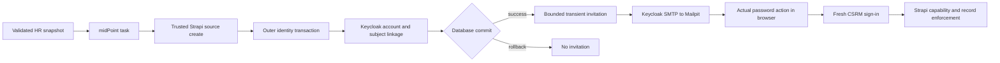

# Phase 5: Sign-in and end-to-end journey - Research

<user_constraints>
## User Constraints (from CONTEXT.md)

The following decisions, implementation discretion and deferred scope are reproduced verbatim from 05-CONTEXT.md.

## Implementation Decisions

### Password email and transaction correctness

- **P5-01 — Eligibility:** Automatically attempt the email only for an actual new IdamBox User created through the trusted Identity Source SCIM create path, with a committed source binding and Keycloak subject. Never send it for a manual create, confirmed claim, mover, reconciliation update, reactivation, duplicate POST, protected user or registered service identity. Recheck current active, unprotected, non-service, non-tombstoned sourced status before dispatch; a newly inactive/future-starting user is skipped and may use the operator path after activation. **Reason:** D17 concerns new sourced people; claims already have credentials, and recurring synchronization must not repeatedly invite people or contact disabled/service users.
- **P5-02 — No provisioned credential:** The source DTO, CSV, mappings and sourced provisioning path carry no password. Send Keycloak `execute-actions-email` with exactly `UPDATE_PASSWORD`; do not call reset-password, generate a temporary password, or insert credentials into the remote create payload for a sourced user. Keep the existing manual-user credential behavior outside this change. **Reason:** Keycloak owns password setup, and the new journey must preserve existing administration compatibility.
- **P5-03 — After the real commit:** Register one bounded best-effort dispatch against the outermost successful transaction commit, after the user and trusted `externalSubject` linkage are durable. A nested Document Service transaction returning is insufficient: `withIdentityUserLock` already surrounds source creates. Never send on rollback, validation/uniqueness failure or failed linkage/commit. Isolate all dispatch errors, including callback/scheduling errors, from the successful SCIM 201 outcome; do not await SMTP delivery in the create transaction or make committed create correctness depend on it. **Reason:** An email cannot be rolled back, and failure after commit must never tell midPoint that a durable create failed. The supported Strapi commit-hook behavior and nested transaction ordering require focused verification before implementation is accepted.
- **P5-04 — Delivery guarantee and recovery:** Choose one automatic post-commit attempt per successful create, with bounded admin-client calls and caught rejection; no application-level retry loop or durable email queue in this phase. A crash between commit and dispatch, shutdown cancellation, timeout or SMTP failure can leave an unsent or uncertain email. Document that limit and recover through explicit operator resend; do not promise exactly-once delivery or resend automatically on duplicate/replayed provisioning. **Reason:** Email is recoverable assistance; leaver work must retain its separate durable guarantee and frozen model.
- **P5-05 — Frozen persistence:** Do not change any content-type schema, generated content-type declaration or JDL. In particular `KeycloakSyncOutbox.operation` remains solely `disableAndEndSessions`; do not add an email operation, reuse a disable row, overload its status/error fields, or create a parallel persisted email entity. **Reason:** The approved schema serves revocation safety, and Phase 5 has no model-change authority.
- **P5-06 — Safe outcome log:** Emit a structured event such as `iam.password_setup_email` with source documentId, user documentId, trigger (`create`/`operator`), outcome (`sent`/`failed`/`skipped`) and a closed reason/error code. Log acceptance by Keycloak as `sent`, not proof of mailbox delivery. Never log email body/address, action URL, password, tokens, cookies, secret, raw request/response, exception message/cause or expanded admin URL. **Reason:** Operators need an actionable target and failure classification without turning diagnostics into password-reset credentials.
- **P5-07 — Operator resend:** Provide a backend administration command, following the existing `scim:token` administration boot pattern, accepting only a non-secret IdamBox User documentId. Re-read eligibility and use its stored `externalSubject`; never resolve the target by a supplied email or arbitrary remote subject, and never create/adopt a remote user during resend. Require provisioning enabled and valid admin configuration; refuse manual, protected, service, inactive, tombstoned, subjectless or missing targets. Return a closed success/failure result and structured event, with no link/token output and no user mutation. Resend is explicit and may invalidate/replace a prior invitation according to Keycloak behavior. **Reason:** This recovers missed/expired invitations without adding a public endpoint, grant, UI, schema or authority bypass. Automated tests cover refusal as well as success.

### Mailpit, authentication and defaults

- **P5-08 — Local SMTP exception:** The development realm seed `docker/keycloak/import/idambox-realm.json` may gain SMTP pointing to compose service `mailpit` on its internal SMTP port 1025, with a fictitious sender and no authentication/TLS required inside the local compose network. Mailpit already exists in `idp`; add no second catcher or public SMTP binding. Document why Phase 5 changes the formerly untouched realm: UPDATE_PASSWORD mail now needs delivery for SIGN-01. Keep audience/basic scopes, clients, fixture subjects and grants intact. Production SMTP credentials/configuration remain deployment concerns. **Reason:** A realm required-action flag alone sends no email; a fresh realm import must reproduce the real setup journey.
- **P5-09 — False defaults and isolated activation:** Keep committed `IDAMBOX_KEYCLOAK_PROVISIONING=false`, `IDAMBOX_KEYCLOAK_TOKEN_VERIFICATION=false` and `CSRM_AUTH_OIDC_ENABLED=false`. Ordinary boot/tests/CI require no Keycloak configuration or network and instantiate no email client/timer while provisioning is off. Enable all three only in the isolated live process environments; disable the development identity bridge there. **Reason:** Existing local and CI contracts must remain deterministic and authentication modes must stay mutually exclusive.
- **P5-10 — Existing OIDC boundary:** Reuse Auth.js sign-in/session handling, the typed Strapi client, `x-csrm-identity-token`, and `/api/v1/me/access`. Keycloak authenticates and Strapi maps an active `externalSubject` and enforces Role → Function → FunctionAPI plus record access. Use the existing realm-registered browser origin `http://localhost:3000` and exact callback/logout paths unless a narrowly justified journey repair is necessary; refuse an occupied gate origin rather than reuse an unknown process. Preserve issuer consistency and existing CSRF/PKCE/state, refresh and logout protections. **Reason:** The journey needs real identity proof through the delivered security boundary, not a fixture session or a second frontend API facade.

### Fresh-stack local gate

- **P5-11 — Location and lifecycle:** Put the reproducible gate and its operating instructions in `docker/midpoint/e2e/`. Start from `docker compose down -v` for the `idp` stack and a fresh, gate-owned Strapi database; resetting midPoint alone is insufficient because stale Keycloak subjects/emails can change results. Use a clearly identified disposable local environment, exclusive backend compilation/listener ownership and private runtime directories. Never point the gate at developer/production records or silently stop an unrelated listener. A failed run needs a new reset before rerun. **Reason:** SIGN-02 explicitly requires a fresh stack, and both provisioning idempotency and Strapi's shared `dist` directory make accidental reuse misleading.
- **P5-12 — Reuse delivered configuration:** Retain pinned runtime/connector versions and the persistent 100/110/140/150/300–340 objects. Deliver the fresh source token through the existing protected token tooling and `render.sh`; apply objects through the reload tooling. Publish whole snapshots only with `hr-publish.sh` and its validator. Use Phase 4's live-sync/reconciliation tasks and native task completion polling, not direct SCIM writes or hand-created shadows to simulate the main lifecycle. **Reason:** The proof must exercise the actual CSV → Identity engine path, including its validation and mappings.
- **P5-13 — Ordered named stages:** Require preflight/reset/readiness → source registration/token/render/reload/connection → CSV joiner → committed Strapi/Keycloak linkage → Mailpit receipt → password setup in Keycloak → fresh CSRM Requestor sign-in and capability checks → CSV mover → CSV leaver → immediate Strapi/API and CSRM refusal → remote disable/session-end completion → evidence/cleanup. Every stage has a deadline and emits safe start/outcome metadata. On any unexpected failure stop dependent work, exit nonzero and name the exact stage; cleanup errors are separate and cannot erase the original failure. **Reason:** One successful script must demonstrate the entire chain, and failures must identify where progress stopped.
- **P5-14 — Bounded task driving:** For the deterministic journey, trigger the existing tasks on demand after each validated snapshot, wait for a new completed run and verify resulting state; suspend competing schedules while these stages run. Record that this is on-demand task driving, not a new claim about a naturally elapsed five-minute cycle. Preserve Phase 4 cadence, connector-side paging and A5 retryLater behavior (five minutes, then every fifteen minutes); do not rewrite them for faster evidence. Choose bounded stage budgets with explicit longer recovery budgets when needed. **Reason:** Phase 4 already proved scheduler timing; Phase 5 proves cross-system sign-in and refusal without schedule races or hidden hot loops.
- **P5-15 — Mail link proof:** Select only the run's fictitious recipient and newly generated matching Mailpit message; poll with a timeout, never accept stale mail or an arbitrary latest message. Extract the UPDATE_PASSWORD link in memory, verify it belongs to the expected local Keycloak realm/origin, and follow that actual link in Playwright. Enter a runtime-generated password in Keycloak's form, then use a fresh browser session to sign in through CSRM and Keycloak with that chosen password. No admin password reset, direct-grant token or preauthenticated cookie may substitute for this happy path. **Reason:** Receipt, self-service password setup and independent sign-in are distinct SIGN-01/02 acceptance facts.
- **P5-16 — Mover continuity:** Change department, title and email through the next CSV snapshot; retain employeeNumber, source binding, IdamBox User documentId and Keycloak subject, and assert the changed values reached Strapi/Keycloak where mirrored. Keep the browser signed in across the move and retain exactly Requestor access; assert no new setup email. **Reason:** Movers must update one existing identity without granting roles or restarting onboarding. Changing username is unnecessary for this journey because the existing Keycloak update deliberately omits immutable usernames.
- **P5-17 — Requestor only:** Compare the actual `/me/access` operation set with the current catalogue-derived birthright Requestor set, and assert absence of explicit Security Analyst/Admin/provisioning grants. In CSRM prove a real Requestor page/action works and analyst/admin navigation is absent; also attempt representative restricted routes/API operations and another Requestor's restricted record and require server refusal. Do not grant an analyst role to the journey person for mover tests. **Reason:** Hidden navigation alone proves nothing; D20 requires least privilege and record-level enforcement.
- **P5-18 — Leaver refusal before expiry:** Publish `terminated`, observe connector `PUT active=false` (never normal DELETE), and verify the same user/source/subject persist inactive. Retain the existing OIDC browser session and a still-valid pre-leaver access token in memory: on the next request require ordinary Strapi 403 for `/me/access`, a previously allowed data/detail operation and a write, using the normal outer API credential as well. Reload/navigate the same browser to protected list/detail URLs and require the existing access-unavailable state with no protected content/actions. Prove this before access-token expiry and independently of Keycloak logout, using a bounded gate hold of revocation if needed; release it and verify outbox completion, remote disabled status, ended sessions and refused fresh sign-in. **Reason:** Immediate refusal comes from Strapi's active-user check; waiting for token expiration or only observing Keycloak logout would hide a broken authorization boundary.

### Browser isolation and evidence

- **P5-19 — Separate opt-in browser config:** Create a dedicated opt-in journey spec/config selected explicitly by the IAM runner, following `refusal-scim.mjs` and `e2e/iam-scim-refusal.spec.ts`. It drives a real isolated `next dev` with OIDC true against the gate's live backend/Keycloak, with one worker and zero retries. Do not import or modify the default `apps/csrm/playwright.config.ts`: it pins OIDC false and starts its own Strapi. Keep the new spec skipped/inert under default discovery and do not change how ordinary CSRM suites run. **Reason:** The standard fixture harness cannot establish live OIDC proof and must retain its existing behavior.
- **P5-20 — Desktop/mobile proof:** Exercise the password setup/sign-in, Requestor view and post-leaver refusal at 1440×900 and 375×812. Use distinct synthetic people per width on the same freshly reset run, with isolated browser contexts and the complete ordered lifecycle for each. Require keyboard-operable controls, visible focus, readable errors and no horizontal overflow. Capture only safe CSRM post-sign-in and refusal screenshots, with no address-bar/token/link/form secrets. Existing semantic tokens/primitives and design direction govern any necessary repair. **Reason:** Both widths need real journey evidence, and a consumed action link cannot be reused as a second setup proof.
- **P5-21 — Secret handling and publication:** No credential as CLI argument, shell trace, environment dump or tracked file. Carry secrets via isolated process environment/stdin or owner-only ignored handoffs; keep the chosen password, Mailpit body/action link and all browser/token/session material in memory or private disposable storage only. Disable Playwright traces, video, automatic failure screenshots, storage-state dumps, raw network logging and reporters/errors that print token-bearing URLs or fill values. Sanitize before writing anything; publish only allowlisted step/status/timing/identity metadata, synthetic state assertions and safe screenshots under the Phase 5 evidence directory. Never publish raw mail or hash/store a reset link as evidence. **Reason:** Action links and browser traces are credentials even when all people are fictitious.
- **P5-22 — Evidence completeness:** Record run id/date, reset result, versions, selected task invocations, CSV key → Identity → Strapi documentId → Keycloak subject linkage, ordered step outcomes, both viewport results and cleanup. Correlate native midPoint audit with sanitized SCIM outcomes; distinguish direct negative probes from connector-origin traffic. Failed/partial runs retain a sanitized failure summary but cannot publish a passing verdict. Preserve Phase 3/4 capture/replay as historical evidence; recapture only if connector requests/mappings actually change, and never fabricate missing envelopes. **Reason:** Discussion choices, offline validators and existing captures cannot attest the new mail-to-browser journey.

### Inherited conflict and regression acceptance

- **P5-23 — Exercise IN-03 explicitly:** Add a named live negative stage, separate from the happy-path people: a CSV mover email collides only in Keycloak with a different controlled synthetic remote subject, while remaining locally unique. Require SCIM 503 with `Retry-After: 30`, rollback of the local mover, unchanged ownership/subject, no duplicate/adoption and no setup email. Record the task error/retry trigger visibly under A5; remove the gate-owned conflicting fixture and prove eventual recovery using the supported retry path, with its own sufficient bounded budget. Expected 503 is success only inside this named assertion, never a generic ignored failure. Leave classification unchanged and describe the operator correction needed for a persistent collision. **Reason:** IN-03 was not exercised in Phase 4; the final journey gate must expose its existing 503 semantics rather than disguise a permanent conflict as an outage or timeout.
- **P5-24 — Offline email tests:** Use an injected fake admin client and the existing Strapi integration harness without Keycloak/midPoint. Cover correct UPDATE_PASSWORD target/action, no password provisioning, post-outer-commit timing, rollback/failed commit no-send, successful create despite email failure/timeout, caught rejection, duplicate/claim/update/manual/protected/service/inactive exclusions, flag-off inertness, safe log redaction and operator resend guards. Test nested transaction behavior through the real Document Service boundary, not only a fake callback. **Reason:** Backend tests and CI must validate the material workflow while remaining independent of the live stack.
- **P5-25 — Final gates and scope discipline:** Before later execution, reconcile the current shared backend and recheck plans. Require unfiltered `pnpm --dir apps/backend test`; report any inherited WINDOWS.md entry 11 compilation failure separately from narrowly scoped diagnostics, with no full-green claim from exclusions. Any `apps/csrm` change stays limited to the journey and requires `pnpm --dir apps/csrm typecheck` and `pnpm --dir apps/csrm test`; run `api:check` if the shared contract changes. Preserve endpoints, grants, catalogue copies and Document Service/identity upsert write enforcement. No new dependency without concrete need, schema change, broader CSRM screen work or runtime success claim is authorized by this discussion. **Reason:** Phase 4's historical exclusions do not satisfy Phase 5's regression criterion, and shared changes must preserve CSRM compatibility.

### Implementation discretion

File names, internal helper boundaries, command naming, closed error-code spelling and exact bounded timeouts remain implementation choices within P5-01–P5-25. Research must establish supported outer-commit hooks and local action-link behavior without weakening the decisions. An unsupported mechanism is a reported blocker, not permission to send inside a transaction, change a schema or bypass the real browser flow.

## Deferred Ideas

Durable email delivery/retry schema, invitation status/resend screens or public endpoints, remote-conflict status reclassification, connector/runtime upgrades, corporate IdP brokering, broader user administration, new HR fields, source badges/read-only HR screens, HR role/group grants and change-log integration are outside this phase. The operator resend command is the bounded recovery path selected here.
</user_constraints>

**Researched:** 2026-10-17
**Domain:** committed source identity onboarding, Keycloak password setup, CSV lifecycle and real OIDC proof.
**Confidence:** Verified installed Strapi behavior; version-specific Keycloak endpoint behavior remains unverified locally.

## Summary

Use the existing trusted source-create boundary to register one best-effort invitation after the real outer transaction commits. Keep synchronous account provisioning and subject linkage intact, and keep password email entirely outside the create transaction's correctness outcome. The installed implementation exposes a usable public commit hook, but callback failure isolation must be supplied explicitly. [VERIFIED: apps/backend/node_modules/@strapi/database/dist/index.js:60-95; apps/backend/node_modules/@strapi/database/dist/transaction-context.js:17-49]

The local checkout contains the pinned Keycloak deployment and application provisioning client, but the local searches did not locate Keycloak 26.6.1 server source or vendor REST documentation. Therefore the exact endpoint query and required-action semantics below are hypotheses for a version-pinned orchestrator checkpoint, not accepted runtime findings. The production change can be implemented and tested against an injected client offline; live acceptance requires the actual email and browser path. [VERIFIED: docker/docker-compose.yaml:6-20; apps/backend/src/keycloak/admin-client.ts:65-107] [ASSUMED: version-specific endpoint behavior; see A1-A4]

**Primary recommendation:** Build roughly ten vertical plans: invitation plus transaction proof, bounded remote call, administration resend, seed/offline gate foundations, complete CSV/mail/browser runner, negative authorization and conflict stages, final offline regression, and explicit orchestrator checkpoints. This is a planning decision under P5-01–25, not an observed runtime result.

## Project Constraints (from AGENTS.md)

- Preserve Strapi as the production API boundary; Keycloak authenticates while Strapi enforces Role → Function → FunctionAPI and record access.
- All IdamBoxUser writes use the identity service and Document Service. Do not add a frontend facade or component fetch calls.
- Use the authoritative project brief, OpenAPI specification, JDL terminology, capability catalogue and BProton design direction.
- Use strict TypeScript, App Router, Server Components where possible, shadcn/ui primitives, semantic tokens and accessible mobile/desktop layouts.
- Keep business logic outside JSX, validate external input through shared schemas, and add automated tests for material workflows.
- Requestor is implicit; Security Analyst explicit. Navigation visibility is not authorization; cross-requestor records remain restricted.
- Advisory assessment assistance cannot release assessments.
- No unexplained dependencies, secrets, node_modules movement or nested history merge.
- Shared backend changes require coordination and renewed plan check before execution; portable planning uses repository-relative paths and no working branch names.
- Issues use the documented GitHub issue workflow; domain documentation remains one root context plus ADRs.

These directives are recorded from AGENTS.md and .planning/PROJECT.md. The current run additionally forbids network, Docker and git writes/commits, and stops at checked plans. No content-type/generated-schema/JDL edits or activation-default changes are authorized. [VERIFIED: AGENTS.md:1-68; .planning/PROJECT.md, “GSD Workstreams”; 05-CONTEXT.md P5-05/P5-09/P5-25] [DECISION: current user constraints]

<phase_requirements>
## Phase Requirements

| ID | Description | Research support |
|---|---|---|
| SIGN-01 | A new sourced user receives Keycloak's set-password email (Mailpit locally); provisioning never sets a password (D17). | Existing passwordless remote-create behavior; after-outer-commit dispatch; bounded client; SMTP seed and actual link proof. |
| SIGN-02 | A scripted local gate proves CSV joiner → sign-in as Requestor → CSV mover → CSV leaver → refused in the UI and the API, with a Playwright sign-in proof at 1440 and 375 (D18). | Existing SCIM runner/session seams; separate real OIDC configuration; CSV task-driven lifecycle; token-before-expiry denial; safe evidence. |

Requirement descriptions are copied from .planning/workstreams/iam/REQUIREMENTS.md:50-51. [VERIFIED: .planning/workstreams/iam/REQUIREMENTS.md:50-51]
</phase_requirements>

## Architectural Responsibility Map

| Capability | Primary tier | Secondary tier | Rationale |
|---|---|---|---|
| Source-create eligibility and identity ownership | Strapi identity service | Database transaction | Trusted creation intent and persisted binding belong to the existing source boundary. |
| Account and subject provisioning | Strapi provisioning middleware | Keycloak Admin API | Preserve existing blocking linkage behavior. |
| Postcommit invitation | Strapi bounded transient dispatcher | Keycloak email action | Noncritical assistance follows successful persistence. |
| Password selection and OIDC authentication | Keycloak | CSRM Auth.js server | Browser follows actual mail action, then signs in independently. |
| Capabilities and inactive-user refusal | Strapi | CSRM typed client/access state | Backend enforces all operations and records. |
| Snapshot validation and lifecycle task driving | Existing HR publisher and midPoint tasks | Gate orchestrator | Exercise delivered CSV connector configuration. |
| Evidence and viewport proof | Opt-in gate/browser runner | Private runtime storage | Explicit live boundaries and allowlisted publication. |

This responsibility allocation is a design decision implementing P5-01–25. Existing boundaries are grounded in identity-service.ts:160-173, register-idambox-user-provisioning.ts:71-100, the phase context and refusal-scim.mjs:83-148.

## Standard Stack

Use installed dependencies only; install nothing for this phase. No registry lookup or package legitimacy network call is permitted or necessary. The versions below are repository declarations, not claims about latest available releases. [DECISION: offline/no-new-dependency constraint]

| Existing component | Declared version | Purpose | Source |
|---|---|---|---|
| Strapi/database | `5.51.0` | Document Service and transaction lifecycle | [VERIFIED: apps/backend/package.json:23-27], quote: `"@strapi/database": "5.51.0"`, `"@strapi/strapi": "5.51.0"` |
| Keycloak container | `26.6.1` | Account/password/OIDC provider | [VERIFIED: docker/docker-compose.yaml:8], quote: `image: quay.io/keycloak/keycloak:26.6.1` |
| Next.js / Auth.js | `16.3.6` / `5.0.0-beta.32` | Existing CSRM sign-in/session boundary | [VERIFIED: apps/csrm/package.json:26-27], quote: `"next": "16.3.6"`, `"next-auth": "5.0.0-beta.32"` |
| Playwright | `1.58.2` | Explicit live browser proof | [VERIFIED: apps/csrm/package.json:41], quote: `"@playwright/test": "1.58.2"` |
| Vitest | `4.1.11` | Existing CSRM unit suite | [VERIFIED: apps/csrm/package.json:54], quote: `"vitest": "4.1.11"` |
| Node test runner | Existing Node runtime | Backend unit/integration tests | [VERIFIED: apps/backend/package.json:14], quote: `node --test --test-concurrency=1 --test-timeout=600000` |

The current host reports Node v24.20.0 and pnpm 11.24.0. This is a host observation, not a portable prerequisite change. [VERIFIED: local node --version / pnpm --version, 2026-10-17]

## Architecture Patterns

### Preserve the delivered request flow



This diagram is the planned flow required by P5-01–25; SMTP and version-specific action behavior require the checkpoint below.

### Concrete installed Strapi commit-hook findings

1. `Database.transaction` reads `transactionCtx.get()`; nested calls reuse the existing transaction. Only `notNestedTransaction` calls the context commit/rollback. The public callback includes `onCommit` and `onRollback`. [VERIFIED: apps/backend/node_modules/@strapi/database/dist/index.js:60-95; quote: `const notNestedTransaction = !transactionContext.transactionCtx.get();`, `onCommit: transactionContext.transactionCtx.onCommit`]
2. Nested context runs reuse the existing callback arrays. Registering through a nested public `strapi.db.transaction(async ({ onCommit }) => ...)` therefore attaches to the outer transaction. Avoid importing private package internals. [VERIFIED: apps/backend/node_modules/@strapi/database/dist/transaction-context.js:17-24; quote: `commitCallbacks: store?.commitCallbacks || []`]
3. Context commit clears the current transaction before awaiting `trx.commit()`, and invokes callbacks only after that await succeeds. A failed commit does not reach the callbacks. [VERIFIED: apps/backend/node_modules/@strapi/database/dist/transaction-context.js:30-49; quote: `store.trx = null;`, `await trx.commit();`]
4. The callbacks run via synchronous `forEach`; returned promises are not awaited. A synchronous callback exception propagates back into `Database.transaction`'s catch after commit; a returned rejected promise can become unhandled. The transactor-completion guard does not make the original exception disappear. [VERIFIED: apps/backend/node_modules/@strapi/database/dist/transaction-context.js:30-49; apps/backend/node_modules/@strapi/database/dist/index.js:89-95; quote: `store.commitCallbacks.forEach((cb)=>cb());`, `throw error;`]
5. Existing source creates already execute under `withIdentityUserLock`; provisioning middleware and user ownership middleware create additional nested transactions. The trusted source-create service is the narrowest location to select only genuine creates after the linked Document Service result. [VERIFIED: apps/backend/src/iam/identity/identity-service.ts:160-173; apps/backend/src/iam/identity/user-lock.ts:35-55; apps/backend/src/keycloak/register-idambox-user-provisioning.ts:71-100; apps/backend/src/iam/identity/register-identity-writes.ts:153-194]

**Prescribed seam:** register only after the successful source-create Document Service call, while still inside the outer lock. Capture only non-secret source/user identifiers; re-read eligibility and stored subject after commit. Select the dependency through an instance-scoped registration, with no client or timer while provisioning is disabled. Keep failures registering optional work isolated from durable-create correctness. This is an implementation recommendation under P5-01/P5-03/P5-09, not an existing module.

**Scheduling:** the hook must be synchronous and non-throwing. Enclose scheduling and safe logging in catches. The deferred function must immediately attach a catch to its full asynchronous operation, including eligibility reads and logger failures; do not pass an async function directly as the commit callback. A one-shot immediate with tracked handles, shutdown cancellation and bounded in-flight work is sufficient; no queue, retry loop or schema. Use an AsyncResource with a detached creation context or equivalent demonstrated instance isolation so deferred work does not inherit source write authority. The cleared database transaction alone does not prove other application AsyncLocalStorage has been cleared. Prove this with tests. [DECISION: implementation prescription; grounded in installed callback behavior and P5-03/P5-04/P5-05/P5-24]

Bound the entire operation, including token acquisition, response body cleanup and eligibility read. A timer racing a promise alone does not cancel work; pass an AbortSignal to cancellable operations, catch late settlements, and limit database coordination through the established worker coordination option if a lock is used. Safe logging must map errors to a closed code without copying message/cause. [DECISION: bounded delivery design; existing revoke pattern verified in apps/backend/src/keycloak/admin-client.ts:119-145; database coordination in apps/backend/src/iam/identity/user-lock.ts:5-22]

### Existing password provisioning facts

The constant is `UPDATE_PASSWORD_REQUIRED_ACTION = "UPDATE_PASSWORD"`; passwordless remote creates use `requiredActions: password ? undefined : [UPDATE_PASSWORD_REQUIRED_ACTION]` and omit credentials. Existing manual password writes may call resetPassword. Preserve that compatibility and never call the provisioning helper to implement operator resend. [VERIFIED: apps/backend/src/keycloak/provision-idambox-user.ts:8-9,29-67; quotes reproduced above]

The existing client method inventory includes `findUserById`, `findUserByEmail`, `createUser`, `updateUser` and `resetPassword`. Add a distinct action-email operation with the revocation-style total-deadline and closed-error treatment; do not reuse the general remote error-message formatter for invitation logs. [VERIFIED: apps/backend/src/keycloak/admin-client.ts:74-107,119-145,247-265; method names quoted verbatim] [DECISION: new bounded operation]

### Administration resend

Follow token-cli administration boot: parse arguments before backend configuration, set administration mode before load, compile/create/load, perform the single bounded action, destroy in finally, and emit only a closed outcome. The existing boot skips seeds and workers after invariant initialization. Resend reads one local documentId, validates current sourced human eligibility and uses only the stored subject; it writes no user data. [VERIFIED: apps/backend/src/iam/scim/token-cli.ts:66-96,100-104,131-144; apps/backend/src/index.ts:50-56] [DECISION: resend design]

### Proposed file boundaries

Names below are planning proposals and do not claim existing paths. Preserve these seams even if the planner selects different names.

| Proposed responsibility | Suggested location |
|---|---|
| Instance-scoped transient dispatcher / eligibility / safe events | apps/backend/src/iam/password-setup/ |
| Administration resend command | apps/backend/src/iam/password-setup/resend-cli.ts |
| Focused tests and real nested-transaction tests | apps/backend/tests/iam-password-setup*.test.ts |
| Journey runner with inert --check | docker/midpoint/e2e/journey.mjs |
| Opt-in browser config/spec | apps/csrm/playwright.iam-journey.config.ts; apps/csrm/e2e/iam-journey.spec.ts |
| Allowlisted evidence contract | Phase 5 evidence directory plus gate validation module |

## Keycloak 26.6.1 Endpoint: Local Evidence Limit and Required Verification

**Observed local evidence:** the deployment pin is `quay.io/keycloak/keycloak:26.6.1`. The realm's browser client has `"clientId": "idambox-csrm"`, the sole redirect `"http://localhost:3000/api/auth/callback/keycloak"`, origin `"http://localhost:3000"`, and direct grants disabled. The existing seed has fixture requiredActions and application scope/audience configuration; preserve them. [VERIFIED: docker/docker-compose.yaml:8; docker/keycloak/import/idambox-realm.json:59-110; exact values quoted here]

No version-specific vendor endpoint source was located in the repository, local temporary directory search, local Maven cache search or cache search. This is a report of search scope, not proof that vendor behavior is absent. No network or container lookup was attempted. The existing application source proves only that passwordless creation sets a required-action list; it cannot prove the server sends email, merges actions or interprets query parameters. [VERIFIED: local research search observations, 2026-10-17; apps/backend/src/keycloak/provision-idambox-user.ts:43-46]

| Candidate contract | Current disposition | Required proof |
|---|---|---|
| PUT /admin/realms/{realm}/users/{id}/execute-actions-email with JSON array [UPDATE_PASSWORD] | [ASSUMED: A1] Version-specific wire contract not available locally. | Read version-pinned UserResource implementation or bundled Admin REST definition and observe exact request/status. |
| Optional client_id, redirect_uri and lifespan are query parameters; redirect requires a valid client redirect, and lifespan is seconds | [ASSUMED: A2] Do not claim exact defaults or validation behavior. | Verify signatures/defaults and invalid combinations against 26.6.1 source and controlled live probes. |
| Realm SMTP configuration is needed for actual delivery; adding requiredActions alone does not deliver a message | [ASSUMED: A3] Consistent with phase intent; not independently verified from vendor sources locally. | Read email provider path, test without SMTP then with mailpit, record safe status and receipt only. |
| A pre-existing UPDATE_PASSWORD required action does not suppress execute-actions-email; endpoint action token vs persisted list semantics | [ASSUMED: A4] Do not assert merge/removal/invalidation details. | Create controlled passwordless user with existing UPDATE_PASSWORD, invoke action mail, receive one fresh message, consume actual link and inspect resulting required actions. Verify operator resend behavior separately. |

**Conservative implementation decision:** omit all optional endpoint query parameters initially. The action completes on Keycloak, after which a fresh browser context independently starts CSRM sign-in. Do not invent an extra redirect registration or send the Auth.js callback as an email completion redirect: no OIDC state was initiated for that callback. If explicit client/lifespan becomes necessary, resolve A2 first and record the chosen validated values; avoid broadening redirect wildcards. This choice is within P5-10/P5-15 discretion and keeps existing scope/client configuration intact.

**Exact orchestrator preparation/probe commands:** after the offline runner is delivered, invoke from repository root:

```sh
node docker/midpoint/e2e/journey.mjs --check
node docker/midpoint/e2e/journey.mjs --probe-keycloak
```

The new --probe-keycloak mode is a required planning deliverable, not an existing command. It must use process environment/private handoffs for credentials, version-check the actual server, drive the controlled cases in the table, and emit an allowlisted result document; no raw HTTP, bearer, mail body or action URL output. Source evidence can be provided as a local version-pinned vendor checkout: open services/src/main/java/org/keycloak/services/resources/admin/UserResource.java and services/src/main/java/org/keycloak/email/DefaultEmailSenderProvider.java there, recording version/commit and relevant line ranges. These are candidate vendor paths to verify, not observed local files. If source is unavailable, recorded live behavioral probes settle only the observed cases. No acceptance claim may replace this with a fake response.

## Inherited Phase 4 Amendments

Use amendments A1–A10 as authoritative operating constraints: renderer injects one protected token placeholder inside the container; publication validates whole snapshots; single-valued HR extensions remain; connector-side paging stays enabled; retries use retryLater triggers after five minutes then every fifteen minutes; displayName may cause an extra PUT; email shape and native claims remain; resource/task import order matters; capture history remains unchanged. [VERIFIED: .planning/workstreams/iam/phases/04-midpoint-configuration/04-CONTEXT.md:153-164]

The live conflict stage must demonstrate the actual persistent retryLater trigger and task error, remove only its own conflicting remote fixture, and allow a 25-minute recovery budget to cover the first trigger plus normal scanner/task latency. This is a conservative selected budget, not a new retry schedule. Normal stages get 180 seconds, setup 300 seconds, SMTP 120 seconds, each viewport lifecycle 600 seconds excluding conflict recovery, total gate 3600 seconds plus independent 60-second cleanup. Preserve failure stage even if cleanup also fails. [DECISION: P5-13/P5-14/P5-23 budget selection]

## Don't Hand-Roll

| Problem | Use instead | Reason |
|---|---|---|
| Transaction completion tracking | Installed public onCommit registration | Nested Document Service completion is too early. |
| Source identity mutation | Existing identity service and Document Service | Preserve ownership, locking, source authority and linkage guards. |
| Password reset form/token | Keycloak actual action URL | The acceptance fact is self-service password choice. |
| Browser authentication | Existing Auth.js/typed Strapi boundary | Preserve PKCE/state/CSRF, session and token verification. |
| CSV validation/publication | Existing hr-publish.sh and validator | Phase 4 proved duplicate keys otherwise overwrite identities. |
| Task completion/retry | Existing native task polling/retryLater | Avoid direct SCIM substitution and fabricated cadence. |
| Browser/evidence orchestration | Existing refusal runner/harness patterns | Reuse private environment/deadline/ownership boundaries. |

These are planning prescriptions under the phase decisions, grounded in the installed transaction findings, identity-service.ts:160-173, token-cli.ts:131-144, refusal-scim.mjs:83-148 and Phase 4 amendments.

## Common Pitfalls

- An async commit callback is not awaited; a synchronous throw can turn a durable create into a reported failure. Test both failures and scheduler/logger exceptions. [VERIFIED: installed transaction source cited above]
- Source-create success does not imply email delivery. Keycloak acceptance is the safe sent outcome, mailbox receipt is a separate live assertion, and timeout can leave delivery uncertain. [DECISION: P5-04/P5-06]
- Default Playwright fixture config is unsuitable for live OIDC. Use a separate config and explicit opt-in flag, one worker, zero retries, no traces/video/failure screenshots/storage state. Keep ordinary discovery inert. [DECISION: P5-19/P5-21]
- A previously valid access token can still be cryptographically valid after deactivation. Prove ordinary API 403 before token expiry and remote logout using the same stored browser session plus a bounded revocation hold. [DECISION: P5-18]
- Mailpit latest-message selection can accept stale mail. Match run recipient, timestamp and message identity, validate local action origin/realm, and retain the link only in private memory. [DECISION: P5-15/P5-21]
- Gate reuse can silently inherit prior Keycloak identities, a developer listener or shared backend dist output. Require exclusive ownership, fresh database and full idp reset, refusing occupied origins and foreign state. [DECISION: P5-11]
- Generic remote error formatters may include remote error text. Invitation diagnostics must never copy them or include email/URL/body/cause. [VERIFIED: apps/backend/src/keycloak/admin-client.ts:247-265] [DECISION: P5-06]

## Code Examples

The following is a design sketch, not an existing API implementation. The installed public hook is verified above. Helpers named here are proposed responsibilities.

```typescript
await strapi.db.transaction(async ({ onCommit }) => {
  // Existing trusted source-create workflow returns a linked user here.
  const user = await createUsingExistingIdentityBoundary();
  try {
    onCommit(() => {
      try {
        detachedScheduler.schedule(() => {
          void Promise.resolve()
            .then(() => dispatchAfterEligibilityRead(user.documentId))
            .catch(() => safeClosedFailureEvent());
        });
      } catch {
        safeClosedFailureEvent();
      }
    });
  } catch {
    safeClosedFailureEvent();
  }
  return user;
});
```

Make safeClosedFailureEvent itself non-throwing. Schedule through a detached resource created outside request/source authority, track shutdown, and attach rejection handling to every asynchronous operation. Do not use this sketch as permission to bypass the real identity service or to add an inner create path. [DECISION: P5-03/P5-24]

## Environment Availability

| Dependency | Current planning sandbox | Execution fallback |
|---|---|---|
| Node/pnpm and installed packages | Available, versions observed above | Run code/schema/static tests offline. |
| Strapi local SQLite harness | Installed test patterns present | Inject admin client; no remote identity services. |
| Docker/idp, Keycloak, Mailpit, midPoint task runtime | Unavailable by explicit sandbox constraint | Orchestrator live checkpoints only. |
| External/vendor documentation network | Forbidden | Local installed source; unresolved Keycloak behavior stays gated. |
| Git writes/commits | Forbidden | Leave planning documents in working tree. |
| Browser live proof | No live stack | Author/configure/check offline; orchestrator runs installed browser later. |

Availability records current task constraints and local observations, not runtime acceptance results.

## Validation Architecture

### Test Framework

The backend uses node:test after application/test TypeScript compilation; CSRM uses Vitest and installed Playwright. The existing real application provisioning integration test supplies a fake Keycloak service and SQLite. The SCIM HTTP harness loads application modules from the compiled application graph so private source authority belongs to the same instance. [VERIFIED: apps/backend/package.json:14; apps/csrm/package.json:9-11; apps/backend/tests/keycloak-provisioning.integration.test.ts:52-93; apps/backend/tests/helpers/iam-scim-http-harness.ts:10-20]

Commands below for new files are proposed executable contracts; files do not exist until implementation plans deliver them.

| Scope | Command | Environment |
|---|---|---|
| Quick type safety | pnpm --dir apps/backend exec tsc --pretty false | Offline |
| Test compilation | pnpm --dir apps/backend exec tsc -p tests/tsconfig.json --pretty false | Offline |
| Focused unit tests | node --test --test-concurrency=1 apps/backend/.tmp/tests-dist/tests/iam-password-setup.unit.test.js | Offline, after compilation |
| Real transaction tests | node --test --test-concurrency=1 --test-timeout=600000 apps/backend/.tmp/tests-dist/tests/iam-password-setup.integration.test.js | Offline, SQLite/injected client |
| Gate behavior tests | node --test docker/midpoint/e2e/journey.test.mjs | Offline |
| Gate static/inert mode | node docker/midpoint/e2e/journey.mjs --check | Offline; no listeners, secrets, runtime state or evidence |
| CSRM checks | pnpm --dir apps/csrm typecheck; pnpm --dir apps/csrm test | Offline |
| Browser static discovery | pnpm --dir apps/csrm exec playwright test --config playwright.iam-journey.config.ts --list | Offline; config must not launch services in list mode |
| Full backend regression | pnpm --dir apps/backend test | Offline, unfiltered; long-running |
| Contract synchronization, only if changed | pnpm --dir apps/csrm api:check | Offline; uses read-only git diff |
| Keycloak contract probe | node docker/midpoint/e2e/journey.mjs --probe-keycloak | Orchestrator live checkpoint |
| Complete live gate | node docker/midpoint/e2e/journey.mjs --run | Orchestrator live checkpoint |
| Existing published proof validation | node docker/midpoint/e2e/journey.mjs --verify-evidence | Offline once sanitized evidence exists |

### Requirements → Test Map

| Requirement | Behavior | Test owner | Required proof |
|---|---|---|---|
| SIGN-01 | Correct target/action, no credentials, bounded client | Unit/integration | Exact JSON action body; stored subject; no reset password. |
| SIGN-01 | After real outer commit; no rollback/failed-linkage/failed-commit email | SQLite integration | Hold outer transaction; observe zero dispatch until commit; force rollback/commit failure. |
| SIGN-01 | Create succeeds if scheduling/client/timeout/logger fails | Unit plus mounted SCIM integration | Original 201 retained; caught rejection; closed safe event. |
| SIGN-01 | Exclusions and explicit resend guards | Unit plus integration | Duplicate, claim, manual, mover, service/protected/inactive/tombstone/subjectless/missing refused or skipped. |
| SIGN-01 | Actual mail and self-selected password | Live gate | Fresh matching Mailpit receipt, validated actual action URL, Keycloak form success, fresh independent sign-in. |
| SIGN-02 | Gate deadlines, stage ordering, cleanup, sanitation, inert check | Offline runner unit tests | Failure naming and fail-closed incomplete evidence; no secret output. |
| SIGN-02 | Complete connector joiner/mover/leaver at each width | Live gate | Native task outcomes, source→Identity→local→remote stable linkage, no mover invite, Requestor only. |
| SIGN-02 | Same-session and pre-expiry API refusal | Live gate | Normal outer API credential plus still-valid identity token, 403 for access/read/write, UI unavailable, no protected content. |
| SIGN-02 | IN-03 remote-only email collision/recovery | Named live stage | 503/Retry-After 30, local rollback, unchanged subject, retryLater trigger, correction and eventual recovery. |
| Both | Full shared regression | Unfiltered offline suite | Report true result, inherited compilation failures separately; exclusions cannot count green. |

### Sampling and gaps

Run focused unit/type checks on each invitation change; run real nested SQLite tests when registration/transaction behavior changes; run offline gate tests for runner/browser handshake changes. Run the unfiltered backend and CSRM checks once after the complete implementation, then rerun only for relevant changes or failures. No execution or test pass is claimed by this research. [DECISION: P5-24/P5-25]

Wave-zero deliverables: injected action-mail client seam; deterministic scheduler/clock/closed log ports; real SQLite source-create fixture with controllable outer commit failure; runner stage/evidence contracts; opt-in browser config and private handshake; tests preventing default-suite activation and secret-bearing output. Existing harnesses are reusable rather than a reason to install another framework.

### Orchestrator live checkpoints and evidence

Before any reset, identify the disposable local idp installation and ensure exclusive backend compilation/listener and localhost:3000 ownership. Credentials enter through private process environment or owner-only handoffs. From repository root, the reset commands are:

```sh
docker compose --project-directory docker -f docker/docker-compose.yaml down -v
docker compose --project-directory docker -f docker/docker-compose.yaml up -d --build
node docker/midpoint/e2e/journey.mjs --probe-keycloak
node docker/midpoint/e2e/journey.mjs --run
node docker/midpoint/e2e/journey.mjs --verify-evidence
```

These are orchestrator-only commands requiring a disposable environment; they are never offline tasks. The runner must create its own fresh backend database and deliver source token/render/reload/task orchestration internally; direct SCIM mutations cannot stand in for lifecycle stages. Exact implementation CLI environment names, task invocations and source-registration commands must be documented by the runner plan, with secret-safe examples. [DECISION: P5-11–14]

Record reset result, observed service/connector versions, run/date, selected task OIDs and new completion outcomes, synthetic key and identity/local/remote IDs, sanitized native audit/SCIM correlation, per-width password/sign-in/requestor/mover/leaver/refusal stages, token-validity timing without token value, outbox/remote-disabled/session-ended outcomes, explicit IN-03 observation/recovery, safe CSRM screenshots and cleanup. Failed or partial evidence cannot receive a passing verdict. No mail/body/action-link/browser-state trace is published. [DECISION: P5-21–23]

## Security Domain

Applicable control areas are authentication, session management, access control, input validation and cryptography. These are a threat-model checklist; no claim about a particular ASVS edition's numbering or compliance certification is made without local source evidence. [DECISION: phase security review]

| Area | Threat | Required mitigation/proof |
|---|---|---|
| Authentication | Bypass actual password setup or fake session | Follow real action link, then new CSRM OIDC context. |
| Session management | Leaver retains cached access | Same-session refresh and still-valid token API 403 before remote logout. |
| Access control | Cross-requestor or analyst privilege | Catalogue-derived operation equality and direct negative route/API/record probes. |
| Input validation | Arbitrary subject resend / action redirect | Local documentId only; stored subject; validated local realm/origin; no wildcard redirect. |
| Cryptography/secrets | Action-link disclosure | Memory/private handoffs; no raw traces, mail, tokens or error causes. |
| Lifecycle reliability | Email failure rolls back or retries committed create | Commit-hook exception containment; no duplicate-trigger resend; operator recovery. |

## Assumptions Log

| ID | Claim | Risk and disposition |
|---|---|---|
| A1 | 26.6.1 action-email endpoint method/path/body contract | Verify version-pinned vendor evidence/live probe before acceptance. |
| A2 | Query names, units, defaults and client/redirect validation | Omit optional query initially; probe explicitly before relying on them. |
| A3 | SMTP and requiredActions alone behavior | Realm seed and controlled no-SMTP/SMTP live probe; mailbox receipt mandatory. |
| A4 | Existing requiredActions and resend token behavior | Probe pre-set UPDATE_PASSWORD and operator resend; do not promise old-link invalidation or exact-once delivery. |

The user delegated noninteractive implementation choices; none of these unresolved server facts becomes a locked factual assertion merely because no question can be answered. Live checkpoints resolve them.

## Open Questions

Only the version-specific Keycloak questions A1–A4 remain unresolved by available local evidence. They do not block offline implementation behind a fake client, but they block live acceptance. Transaction semantics are resolved in installed source and still require behavioral integration coverage.

## Sources

Primary local sources inspected this session:
- Installed @strapi/database dist/index.js:60-95 and transaction-context.js:17-83: public nested hook registration, commit ordering, callback errors.
- apps/backend/src/iam/identity/identity-service.ts:160-173; user-lock.ts:35-55; register-identity-writes.ts:153-194: source create, locks, ownership.
- apps/backend/src/keycloak/register-idambox-user-provisioning.ts:71-100; provision-idambox-user.ts:8-87; admin-client.ts:74-145,184-239,247-265: linking, passwordless action, bounded revocation analogue, error handling.
- apps/backend/src/iam/scim/token-cli.ts:66-144 and src/index.ts:50-56: administration boot/cleanup.
- apps/backend/tests/keycloak-provisioning.integration.test.ts:52-93; helpers/iam-scim-http-harness.ts:10-20: installed offline patterns.
- docker/docker-compose.yaml:6-20; docker/keycloak/import/idambox-realm.json:59-110: runtime pin, browser client restrictions.
- docker/midpoint/e2e/refusal-scim.mjs:83-148; apps/csrm/e2e/iam-scim-refusal.spec.ts:1-20: isolated OIDC/browser precedent.
- Phase 5 context; IAM requirements/state/roadmap; Phase 4 context amendments: authoritative scope and inherited behavior.
- AGENTS.md; .planning/PROJECT.md; docs/CSRM-PROJECT-BRIEF.md; docs/design/csrm-design-direction.md: project boundaries.

No remote lookup was performed. No current-version registry claim or Keycloak vendor-source claim is implied.

## Metadata

Research date: 2026-10-17. Installed-source transaction facts are valid only while the inspected dependency implementation remains unchanged. Recheck shared backend and pinned server behavior before execution. No implementation, live result, commit or completion-state change is supplied by this file.

