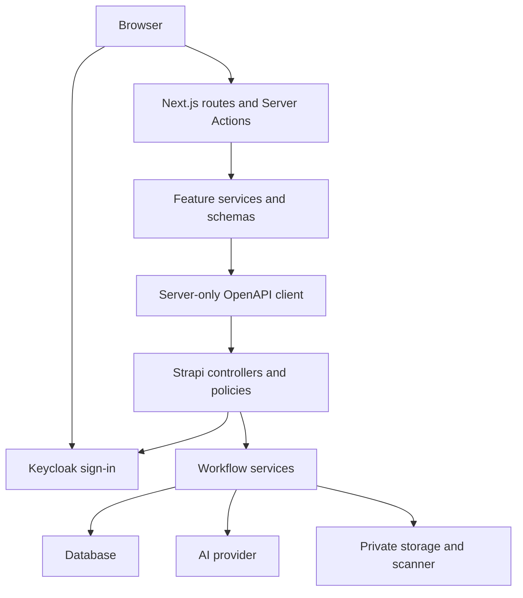

<!-- generated-by: gsd-doc-writer -->
# CSRM architecture

## System overview

Next.js renders Requestor and Security Analyst workflows. Server-only feature services call Strapi through the typed OpenAPI client; Strapi owns persistence, authorisation and workflow transitions. Keycloak supplies OIDC identity. AI produces reviewable assistance, never release authority.

## Component diagram

CSRM business requests pass through Next.js server code. The NextAuth callback is an authentication route, not a frontend business API facade. Strapi's admin panel is a separate operator surface.

## Data flow

1. A route or Server Action resolves the session and checks capabilities. Navigation visibility is not authorisation.
2. A feature service validates input and calls `createStrapiClient()` in `apps/csrm/src/lib/api/transport/server-client.ts`.
3. The transport supplies the server-only Strapi API token and actor identity. Strapi resolves the IdamBox User, checks FunctionAPI and record scope, and passes the authorised context to the workflow.
4. Services validate mutable state and perform transactional writes. Web feature schemas validate responses before rendering.
5. A human analyst explicitly releases a ready assessment; assessment and owning-request release facts commit atomically.

OIDC forwards the caller's Keycloak token in `x-csrm-identity-token`, verified by Strapi against the issuer and user `externalSubject`. Development uses `x-csrm-dev-identity` behind runtime gates.

## Key abstractions

| Location | Responsibility |
|---|---|
| `apps/csrm/src/lib/auth/development-runtime.ts` | Select OIDC, development or unavailable session mode |
| `apps/csrm/src/lib/api/transport/server-client.ts` | Typed transport and normalised errors |
| `apps/csrm/src/features/requests/request-service.ts` | Request operations and response parsers |
| `apps/csrm/src/lib/capabilities/server-guard.ts` | Server-side route/action checks |
| `apps/backend/src/policies/csrm-authorization.ts` | Grants, owner scopes and human analyst restrictions |
| `apps/backend/src/api/csrm-assessment/services/assessment-workflow.ts` | Mutable aggregate writes, readiness and release |
| `apps/backend/src/api/csrm-ai-run/services/ai-run-record.ts` | Bounded persisted provenance and decisions |
| `apps/backend/src/csrm/files/attachment-config.ts` | Private storage and scanner configuration |

Requestor is a birthright role; Security Analyst is explicit. Released assessments are read-only. An automation identity cannot act as a human analyst.

## Directory structure rationale

| Directory | Purpose |
|---|---|
| `apps/csrm/app/` | Route composition, layouts, loading/error boundaries and actions |
| `apps/csrm/src/features/` | Feature services, schemas, domain logic and UI |
| `apps/csrm/src/components/` | Shared primitives, shell and state presentations |
| `apps/csrm/src/lib/` | Sessions, transport, capabilities and infrastructure |
| `apps/backend/src/api/` | Content types, routes, controllers and services |
| `apps/backend/src/csrm/` | Shared CSRM AI, file, policy and insight modules |
| `apps/backend/src/keycloak/` | Provisioning and token verification |
| `apps/backend/src/bootstrap/` | Seeds and boot reconciliation |
| `docs/references/` | API, JDL and capability catalogue contracts |
| `docker/` | Local Keycloak and ClamAV Compose services and realm import |

## Operational boundaries

Job scheduling, attachment rescans and extraction queues contain in-process state. Durable AI run records do not make scheduling distributed. See [Residual risks](../security/phase-08-residual-risks.md) before operating multiple Strapi processes. Database configuration has SQLite, PostgreSQL and MySQL branches; the installed runtime database driver is SQLite. Other databases need their driver and deployment validation.

See [Configuration](../configuration/configuration.md), [Frontend components](../frontend/components.md) and [Backend services](../services/backend-services.md).
